# How the decode attention kernel is written on a Tensix core, and how the Palu kernel changes it

A reader's guide to two kernels: tt-metal's flash-decode op (`ttnn.transformer.scaled_dot_product_attention_decode`,
the attention step of every stock decode in this study) and the fused Palu op built on top of it
(`ttnn.transformer.palu_sdpa_decode`, stages 2, 2b and 2c). It assumes you know what attention and a KV cache are and
nothing about Tenstorrent hardware. Part A introduces the machine in exactly the depth the two kernels need. Part B
walks through flash decode as it is written, function by function. Part C walks through what the Palu kernel adds,
and closes with why it costs what the stage 2d profile measured.

All sizes are for the configuration this study ran: Llama-3.1-8B-Instruct split over the two chips of an n300, so
each chip sees 16 query heads and 4 KV heads of head dim 128; batch 32; a 512-position K chunk; fp32 destination
accumulation. Where a number depends on that configuration it says so. Source paths are relative to the tt-metal
submodule, `third_party/tt-metal/`.

---

## Part A. The machine the kernel runs on

### A1. The chip, the core, and the five RISC-V processors

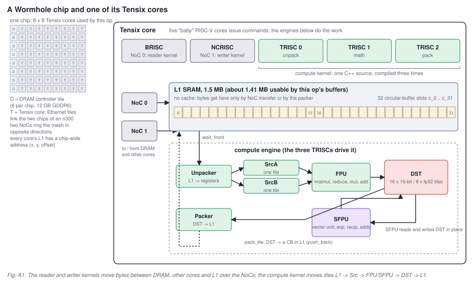

A Wormhole chip is a mesh of tiles connected by two networks-on-chip (NoCs). Most tiles are **Tensix cores**; the
rest are DRAM controllers, Ethernet ports (which link the two chips of an n300) and management. This op uses an
8 x 8 grid of Tensix cores on each chip. Every core's local memory is visible chip-wide: an L1 address is
(x, y, offset), so any core can read or write any other core's L1, and a DRAM buffer is spread page by page across
the DRAM controllers ("interleaved").

Inside one Tensix core there are five small in-order RISC-V processors. They do not do the arithmetic; they issue
commands to the engines around them:

| processor | role in a tt-metal program | what it drives |
|---|---|---|
| BRISC | the **reader kernel** (data movement 0) | NoC 0: DRAM and remote-L1 reads into local L1 |
| NCRISC | the **writer kernel** (data movement 1) | NoC 1: L1 to DRAM and to other cores; semaphores |
| TRISC 0 | the **compute kernel**, unpack thread | the unpacker: L1 tiles into the SrcA / SrcB registers |
| TRISC 1 | the compute kernel, math thread | the FPU (matrix engine) and the SFPU (vector engine) |
| TRISC 2 | the compute kernel, pack thread | the packer: DST register tiles back into L1 |

A tt-metal op is therefore three source files per core: a reader, a compute kernel and a writer. The compute
kernel is one C++ file compiled three times, once per TRISC; every compute API call (`matmul_block`, `mul_tiles`,
`pack_tile`, ...) expands to the piece of work that belongs to that thread, so the three binaries execute the same
program in lock-step through the circular buffers and the DST register described below. There is no cache anywhere:
L1 is 1.5 MB of plain SRAM, and every byte in it was put there by a NoC transfer or by the packer.

### A2. Tiles and data formats

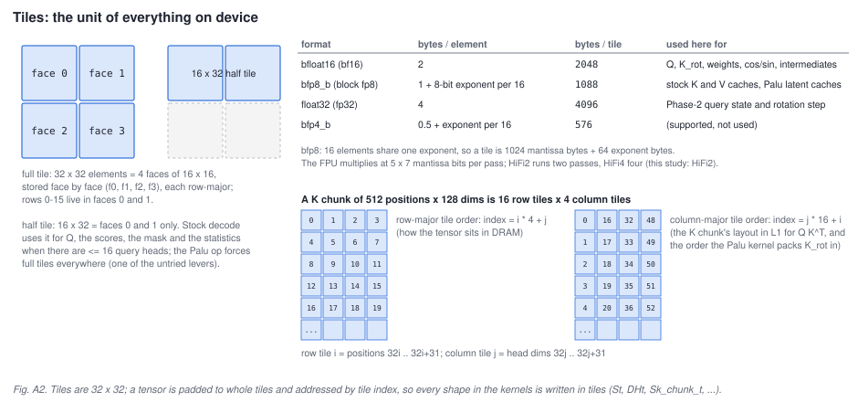

The unit of storage and computation is the **tile**: 32 x 32 elements, stored as four 16 x 16 faces. A tensor is
padded to whole tiles and addressed by tile index, which is why every shape in the kernel source is written in
tiles: `St` (sequence length in tiles), `DHt` (head dim in tiles = 4), `Sk_chunk_t` (K chunk in tiles = 16 for a
512-position chunk), `PNHt` (padded query heads in tiles = 1: the 16 query heads sit in the first 16 rows of one
tile). A tile is 2 KB in bfloat16, 4 KB in fp32 and 1088 B in `bfp8_b`, the block-floating-point format the KV
caches use (16 elements share one 8-bit exponent). The FPU multiplies 5 x 7 mantissa bits per pass and the
"math fidelity" says how many passes it makes; this study runs HiFi2, two passes, in both kernels.

Two things about tiles matter later. First, the flash-decode kernel uses **half tiles** (16 x 32, faces 0 and 1
only) for Q, the scores, the mask and the softmax statistics whenever there are 16 or fewer query heads, which
halves the work on those operands; the Palu op forces full tiles everywhere. Second, a matrix of tiles can be
stored in either of two orders, and the K chunk uses both: row-major in DRAM (tile `i*4 + j`) and column-major in
L1 (tile `j*16 + i`), because the Q K^T matmul reads its second operand transposed and wants each column of K
tiles contiguous. The Palu kernel has to reproduce that L1 order when it builds K itself.

### A3. Circular buffers: how the three kernels talk

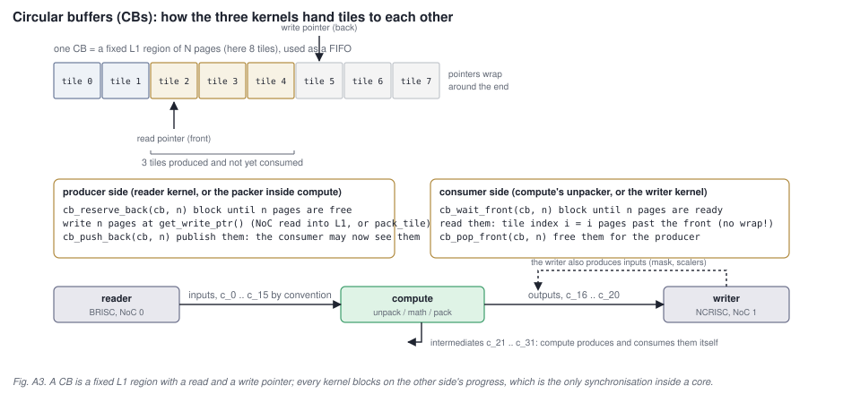

A **circular buffer** (CB) is a fixed region of L1 used as a FIFO of pages (one page is one tile here). There are
32 CB slots per core, `c_0` to `c_31`; the host decides each slot's size and tile format when it builds the
program, and the kernels refer to slots by number. Every CB has one producer and one consumer, and the two sides
use four calls:

```
producer:  cb_reserve_back(cb, n)   -> write n pages at get_write_ptr() -> cb_push_back(cb, n)
consumer:  cb_wait_front(cb, n)     -> read pages at get_read_ptr()     -> cb_pop_front(cb, n)
```

`reserve_back` blocks until `n` pages are free; `wait_front` blocks until `n` pages have been pushed. That
blocking is the **only** synchronisation between the reader, the compute kernel and the writer on a core: nobody
sends messages, everybody waits on a CB. Inside the compute kernel the same calls split across threads: the
unpacker waits and pops, the packer reserves and pushes. Two consequences shape both kernels:

- A tile read by the compute kernel is addressed as "`i` pages past the front" and that address does **not** wrap
  at the end of the buffer, so a block of tiles that is read as one operand must be contiguous. The Palu op
  sizes its CBs as whole multiples of the blocks it pushes for exactly this reason.
- A push is a block: the pages are written linearly from the write pointer. A reader that pushes 9-tile blocks
  into a 17-tile CB would eventually write past the end, so CB sizes are multiples of the push granule.

By convention `c_0` to `c_15` are inputs (reader or writer to compute), `c_16` to `c_20` outputs (compute to
writer), and `c_21` to `c_31` intermediates that the compute kernel produces and consumes itself.

### A4. The compute engine: SrcA, SrcB, FPU, SFPU, DST and the round trip

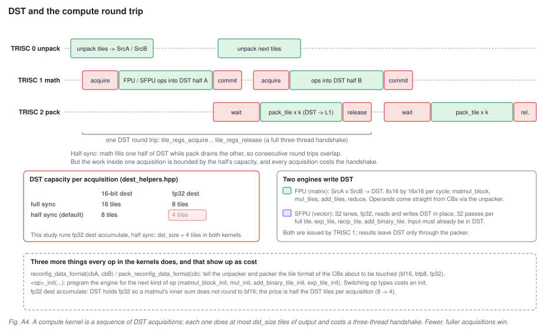

Arithmetic happens in three stages with dedicated registers between them:

1. The **unpacker** (TRISC 0) reads tiles from a CB in L1 into **SrcA** and **SrcB**, converting the CB's format
   (bfp8, bf16, fp32) into the engine's internal format on the way.
2. The math thread (TRISC 1) issues instructions to one of two engines. The **FPU** is the matrix engine: it
   multiplies an 8 x 16 slice of SrcB by a 16 x 16 slice of SrcA every cycle and accumulates into **DST**, and it
   also does reductions and element-wise add, subtract and multiply of two tiles. The **SFPU** is a 32-lane fp32
   vector unit that reads a tile *from DST*, applies a function (exp, reciprocal, add of two DST tiles, ...) and
   writes it back to DST in place; a full tile takes it 32 passes.
3. The **packer** (TRISC 2) copies a finished DST tile into a CB in L1, converting to that CB's format, and pushes
   it.

**DST** is the accumulator register file. It holds 16 tiles of 16-bit data or 8 tiles of fp32. It is normally run
in *half-sync* mode: the math thread fills one half while the packer drains the other, so consecutive steps
overlap. Both kernels in this study run with **fp32 destination accumulation** (so the inner products of the
matmuls do not round to bf16 between tiles) and half-sync, which leaves **4 tiles of DST per step**. The program
factory calls this `dst_size = fp32_dest_acc_en ? 4 : 8` and sizes every matmul sub-block and every element-wise
loop to it.

Every unit of compute work is a **DST round trip**, four calls that fence the three threads:

```
tile_regs_acquire();   // math: wait until my half of DST is free
... FPU / SFPU instructions producing up to dst_size tiles ...
tile_regs_commit();    // math: the tiles are ready
tile_regs_wait();      // pack: wait for that commit
pack_tile(i, cb, ...); // pack: DST tile i -> L1 (repeated per tile)
tile_regs_release();   // pack: give the half back to math
```

A round trip does at most `dst_size` tiles of output and costs a full three-thread handshake, so kernel time is
governed by *how many round trips* a computation takes as much as by how many FLOPs. Three smaller costs travel
with every operation and appear in the kernels as boilerplate: `reconfig_data_format(cbA, cbB)` and
`pack_reconfig_data_format(cb)` tell the unpacker and packer which tile format the next operands have; `*_init`
calls (`matmul_block_init`, `mul_init`, `add_binary_tile_init`, `exp_tile_init`) program the engine for the next
kind of instruction; and switching between them is not free. These three ideas, few and full round trips, few
reconfigurations, few init switches, are the whole story of Part C.

### A5. The NoC, semaphores, and what the host decides

The reader and writer move data with **asynchronous NoC transactions**: `noc.async_read(src, dst, bytes)` returns
immediately and `noc.async_read_barrier()` waits for all outstanding reads. A DRAM tensor is read one tile at a
time (each tile is a page), and the readers here issue a barrier every few tiles so the number of reads in flight
stays bounded. Because every core's L1 has a chip-wide address, a writer can also `async_write` straight into
another core's CB region, and signal it with a **semaphore**: a 32-bit word at the same L1 offset on every core
that a remote core increments atomically and a local core polls. Flash decode uses exactly this to merge partial
results across cores.

Everything that is not the kernels themselves is the **program factory** on the host
(`sdpa_decode_program_factory.cpp`, and the Palu copy of it). It decides how work is spread over the grid, sizes
every CB, chooses matmul sub-block shapes from `dst_size`, and hands each core its **compile-time arguments**
(shapes, flags, CB indices, baked into the binary) and **runtime arguments** (buffer addresses, which item this
core owns, its role in the reduction tree). One kernel binary runs on all 64 cores; the runtime arguments make
them do different work.

---

## Part B. Flash decode as written

### B1. The problem and the online softmax

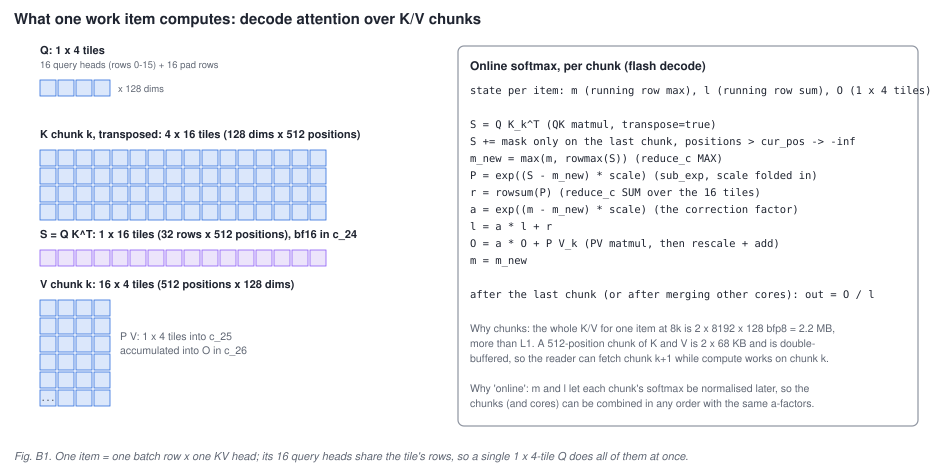

One **work item** is one batch row and one KV head. Its query is a single tile: the 16 query heads of this batch
row are the tile's rows (padded to 32), so a single 1 x 4-tile Q multiplies against the whole K chunk at once. Its
K and V are `S x 128` each; at 4k that is 4096 rows, at 8k it is 2.2 MB of bfp8 for the pair, more than L1. So
the item is processed in **chunks** of 512 positions (16 row tiles), and the softmax is computed "online": per
item the kernel keeps a running row-max `m`, a running row-sum `l` and an unnormalised output accumulator `O`, and
per chunk it computes

```
S      = Q K_k^T                          scores, 1 x 16 tiles
S     += mask                             last chunk only: positions > cur_pos become -inf
m_new  = max(m, rowmax(S))
P      = exp((S - m_new) * scale)         the softmax scale is folded into the exponent
r      = rowsum(P)
a      = exp((m - m_new) * scale)         correction factor for everything accumulated so far
l      = a * l + r
O      = a * O + P V_k
m      = m_new
```

and after the last chunk divides `O` by `l`. Nothing about this is specific to Tenstorrent; what is specific is
how each line maps onto CBs and DST round trips (B3).

A detail that matters for the numbers: KV head `h` serves only 4 of the 16 query heads (GQA with 16 query and 4 KV
heads per chip), but the Q tile carries all 16 rows. The kernel computes scores for all 32 rows of the tile and
the writer stores only the 4 rows that belong to this KV head. A tile is the minimum unit, so the other rows are
computed and discarded.

### B2. Work layout: which core does what

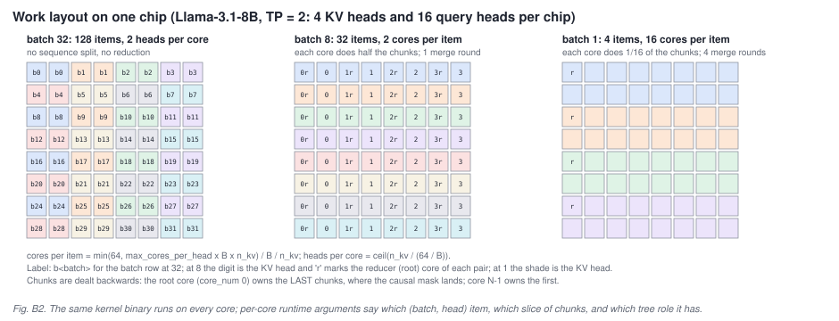

The factory spreads `batch x n_kv` items over the 64 cores. With `max_cores_per_head_batch` capping the split, the
rule is `cores per item = min(64, cap x B x n_kv) / B / n_kv` and, when there are more items than cores,
`heads per core = ceil(n_kv / (64 / B))`. For this model:

| batch | items | per core | per item | sequence split | reduction rounds |
|---|---|---|---|---|---|
| 32 | 128 | 2 KV heads, run one after the other | 1 core | none | 0 |
| 16 | 64 | 1 head | 1 core | none | 0 |
| 8 | 32 | 1 head | 2 cores | each core does half the chunks | 1 |
| 1 | 4 | 1 head | 16 cores | each core does 1/16 of the chunks | 4 |

When an item spans several cores the chunks are dealt out backwards: core number 0 of the group (the **root**)
owns the last chunks, where the causal mask lands, and the highest-numbered core owns the first. A core that ends
up with no chunk returns immediately and is dropped from the reduction tree. Every core runs the same binary; its
runtime arguments say which batch row, which head group, which slice of chunks, and which tree role.

### B3. Inside one core, for one chunk

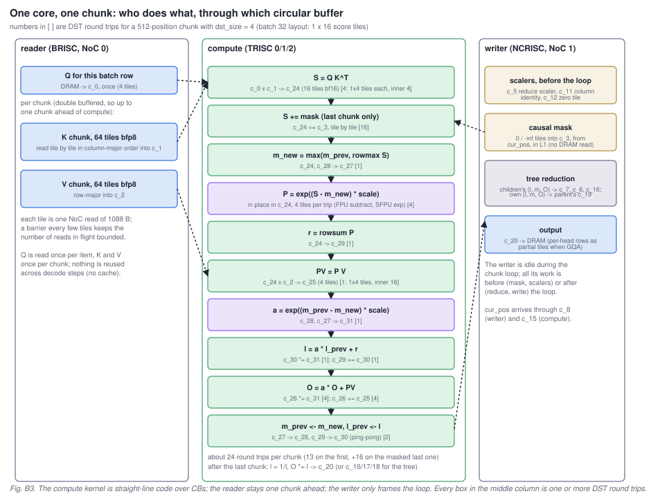

**Reader** (`reader_decode_all.cpp`). Reads the item's Q tile once into `c_0`. Then, per chunk, reads the K chunk
tile by tile from DRAM into `c_1` in column-major order (the transposed layout the QK matmul wants) and the V
chunk row-major into `c_2`. Both CBs hold two chunks, so the reader can run up to one chunk ahead of compute. One
tile is one NoC read of 1088 bytes; the reader barriers every few tiles. `cur_pos` for the batch row arrives
through a one-page CB (`c_8` for the writer's copy, `c_15` for compute's) so the kernels can size their work
without a host round trip.

**Writer** (`writer_decode_all.cpp`). Before the loop it manufactures the constants the compute kernel needs
directly in L1: the reduce scaler (`c_5`), a column-identity tile (`c_11`), a zero tile (`c_12`), and the **causal
mask** into `c_3`: from `cur_pos` it fills whole tiles with 0 or -inf and one partial tile at the boundary, so no
mask is ever read from DRAM. It is idle during the chunk loop. After the loop it runs the cross-core merge (B5)
and writes the result from `c_20` to DRAM, storing only this KV head's 4 rows of each output tile.

**Compute** (`sdpa_flash_decode.cpp`, helpers in `sdpa/device/kernels/compute/compute_common.hpp`). Straight-line
code over CBs. Per chunk, with the round-trip count in brackets for this configuration (`dst_size = 4`, scores
1 x 16 tiles, output 1 x 4 tiles):

| step | helper | CBs | round trips |
|---|---|---|---|
| `S = Q K^T` | `matmul_blocks(..., transpose=true)` | `c_0`, `c_1` -> `c_24` | 4 (sub-blocks of 1 x 4 output tiles, inner dim 4) |
| `S += mask` (last chunk, root core only) | `add_block_inplace` | `c_24` += `c_3` | 16 (one tile each) |
| `m_new = max(m_prev, rowmax S)` | `reduce_c<MAX>` with the previous max copied into DST first | `c_24`, `c_28` -> `c_27` | 1 |
| `P = exp((S - m_new) scale)` | `sub_exp_block_bcast_cols_inplace`: FPU subtract with the max broadcast along the row, SFPU exp, packed back in place | `c_24` | 4 (4 tiles per trip) |
| `r = rowsum P` | `reduce_c<SUM>` | `c_24` -> `c_29` | 1 |
| `PV = P V` | `matmul_blocks` | `c_24`, `c_2` -> `c_25` | 1 (1 x 4 output tiles, inner dim 16) |
| `a = exp((m_prev - m_new) scale)` | `sub_exp_block` | `c_28`, `c_27` -> `c_31` | 1 |
| `l = a l + r` | `mul_block_inplace`, `add_block_inplace` | `c_30`, `c_29` | 2 |
| `O = a O + PV` | `mul_block_bcast_cols`, `add_block_inplace` | `c_26`, `c_31`, `c_25` | 8 |
| `m_prev <- m_new`, `l_prev <- l` | `move_block` into the ping-pong slots | `c_27` -> `c_28`, `c_29` -> `c_30` | 2 |

About 24 round trips per chunk, 13 on the first chunk (no rescaling yet) and 16 more on the masked last chunk.
The max and sum live in ping-pong pairs (`c_27`/`c_28`, `c_29`/`c_30`) so a step can read the previous value
while writing the new one. After the last chunk the root core computes `1/l` (`recip_block_inplace`), scales `O`
by it and moves the result to `c_20`; a non-root core moves its `(O, m, l)` to `c_16`, `c_17`, `c_18` for the
writer to send on.

Three optimisations are folded into that table. The softmax scale is never applied to `S`; it rides inside the
two `exp` calls, which is free. The reduce for the max also performs the element-wise max with the previous
chunk's max in the same round trip. And the main `exp` over the scores runs in the SFPU's approximate mode with
input clamping disabled (hard-coded in the helper), relying on the packer's ReLU to zero the garbage the
approximation produces for very negative inputs; the model's program config turns approximation off only for the
two correction-factor exps.

### B4. Pipelining across chunks

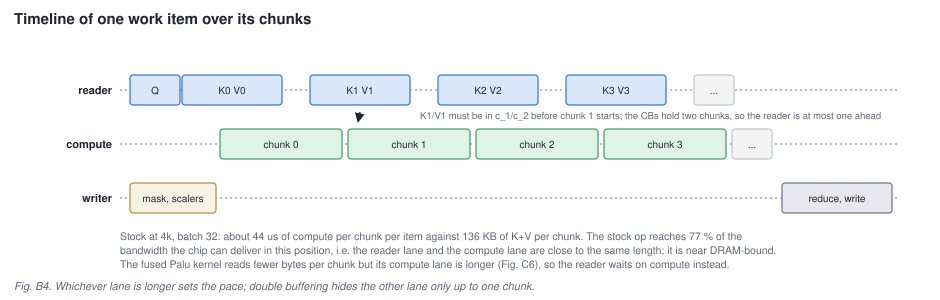

Because `c_1` and `c_2` hold two chunks, the reader fetches chunk `k+1` while compute works on chunk `k`; whichever
lane is longer sets the pace, and double buffering hides the shorter one only up to one chunk. Stock is close to
balanced: at 4k and batch 32 it spends about 44 microseconds of compute per item per chunk against 136 KB of K
and V per chunk, and the stage 2d profile put the op at 77 % of the DRAM bandwidth the chip can deliver in that
position. The fused Palu kernel reads fewer bytes per chunk but has a longer compute lane, so its reader waits on
compute instead (Part C).

### B5. When an item spans several cores: the reduction tree

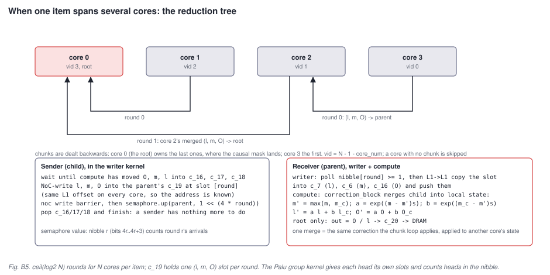

With `N` cores per item, each core produces a partial `(O, m, l)` over its slice of chunks, and the partials are
merged in `ceil(log2 N)` rounds along a binary tree (`get_tree_reduction_params` in
`sdpa_decode_device_operation.hpp`). Core numbers are mapped to `vid = N - 1 - core_num`; in round `r` a core
whose low `r + 1` bits of `vid` are all ones receives from `vid - 2^r`, and a core sends at the round given by the
number of trailing ones in its `vid`. Core 0 is the root.

The transport is the writer kernel: the child waits until compute has moved `O`, `m`, `l` into `c_16`, `c_17`,
`c_18`, NoC-writes them into the **parent's** `c_19` at the slot reserved for that round (every core's `c_19`
sits at the same L1 offset, so the parent's address is known), issues a write barrier, then increments the
parent's semaphore by `1 << (4 * round)`: the 32-bit semaphore is used as eight 4-bit counters, one per round.
The parent's writer polls its nibble, copies the slot L1-to-L1 into `c_7` (l), `c_6` (m), `c_16` (O) and pushes
them; the parent's compute merges with `correction_block`, which is the chunk correction applied to another
core's state:

```
m'  = max(m, m_child);  a = exp((m - m') scale);  b = exp((m_child - m') scale)
l'  = a l + b l_child;  O' = a O + b O_child
```

`correction_block` does its six steps in one round trip by staging five operands in DST registers 0 to 4. Keep
that number in mind: under fp32 accumulation the program's DST window is four tiles, and the Palu group kernel
found out what happens when it is exceeded (C5).

### B6. Numbers for this model

Per layer at batch 32 the stock op takes 0.22 ms at 1k, 0.76 ms at 4k and 1.46 ms at 8k (the 8k figure is the
same stock op measured inside the naive Palu rows, since a whole stock step does not allocate at 8k); a
least-squares fit over the chunk counts gives about 48 microseconds of fixed cost per layer per call plus
88 microseconds per chunk, i.e. 44 per item per chunk since every core runs two items back to back. The op moves
136 KB per item per chunk and reaches 74 to 80 % of the in-situ DRAM roofline at 4k and 8k. That is the bar the
fused kernel is measured against.

---

## Part C. The fused Palu kernel

### C1. What changes in the data

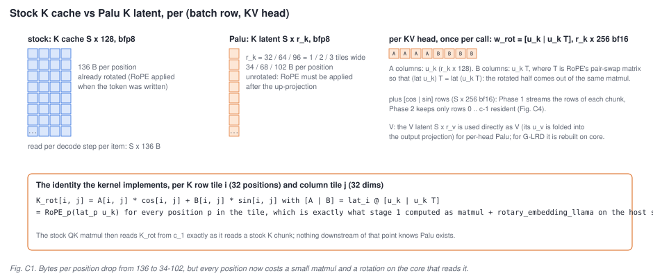

Palu stores, per KV head, a **latent** `S x r_k` instead of the rotated K cache `S x 128`, with `r_k` 32, 64 or
96 (one to three tiles wide). K is recovered as `RoPE_p(lat_p u_k)`: an up-projection by a per-head matrix
`u_k` (`r_k x 128`) followed by the rotary embedding for the token's position. Stage 1 did that as two separate
device ops before every attention call and paid 207 ms per step at 4k for it. The fused kernel does it inside the
attention op, chunk by chunk, so the full K never exists outside L1.

The rotation is written the way the stock RoPE op writes it: `out = x * cos + (x T) * sin`, where `T` is a fixed
128 x 128 pair-swap matrix and `cos`, `sin` are the position's angle table row. Because `(lat u_k) T = lat (u_k T)`,
the host packs `w_rot = [u_k | u_k T]` (`r_k x 256`, bf16) once per head, and a single matmul of a latent row
tile against it yields both halves, `A = lat u_k` and `B = lat u_k T`. Per K row tile `i` and column tile `j`:

```
K_rot[i, j] = A[i, j] * cos[i, j] + B[i, j] * sin[i, j]
```

V is handled two ways. For per-head Palu (M-LRD) the V latent `S x r_v` is used directly as V and its `u_v` is
folded into the output projection, so the op's V input is simply narrower. For grouped latents (G-LRD, stage 2b)
`u_v` cannot be folded without widening the output projection fourfold, so V is rebuilt on core as well (C5).

### C2. The op envelope and the borrowed CB slots

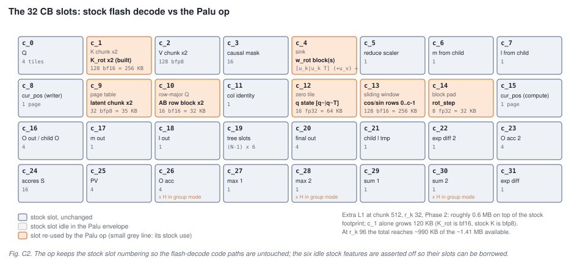

The Palu op is a verbatim copy of flash decode (`palu_sdpa_decode/`) with a narrower envelope: causal, unpaged,
no attention mask tensor, no attention sink, no sliding window, no sub-tile block padding, `cur_pos` as a tensor,
Q in tile layout. Those exclusions are not incidental. The stock op uses all 32 CB slots, and the six features
switched off are the owners of the six slots the Palu kernel needs; the factory refuses to build if any of them is
on, and the kernels `static_assert` the same contract. Sizes at chunk 512, `r_k` 32, `r_v` 128, Phase 2:

| slot | stock use | Palu use | tiles | bytes |
|---|---|---|---|---|
| `c_1` | K chunk, double buffered, bfp8 | `K_rot`, built on core, bf16 | 128 | 256 KB (stock: 136 KB) |
| `c_4` | attention sink | `w_rot` block(s) `[u_k \| u_k T]` (+ `u_v`) + the `T` tile, resident | 2 x 9 | 36 KB |
| `c_9` | page table | latent chunk, double buffered, bfp8 | 32 | 34 KB |
| `c_10` | row-major Q | one `AB` row block, ping-pong, bf16 | 16 | 32 KB |
| `c_12` | zero tile | Phase 2 query state `[q~ \| q~ T]`, fp32 | 16 | 64 KB |
| `c_13` | sliding-window mask | cos/sin rows 0 .. c-1, resident, bf16 | 128 | 256 KB |
| `c_14` | block-padding mask | `rot_step` `[cos(c f) \| sin(c f)]`, fp32 | 8 | 32 KB |

Roughly 0.6 MB on top of the stock footprint at `r_k` 32, about 990 KB in total for the new and changed CBs at
`r_k` 96, inside the 1.41 MB the allocator gave this op. Every one of these CBs is a whole number of the blocks
pushed into it, for the no-wrap reasons in A3. Everything downstream of `c_1` is untouched stock code: the QK
matmul reads `K_rot` exactly as it would read a K chunk.

### C3. Rebuilding one K chunk on the core

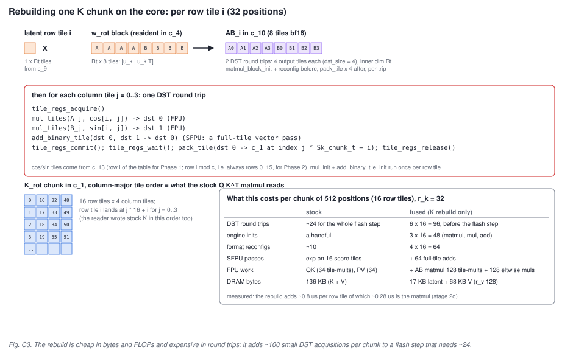

`palu_build_k_chunk` (`palu_compute_common.hpp`) runs once per chunk, before the stock flash step, and loops over
the chunk's 16 row tiles. Per row tile `i`:

1. **`AB_i = lat_i @ w_rot`.** The latent row tile (1 x `Rt` tiles, `Rt` = `r_k`/32) is multiplied by the
   resident weight block (`Rt` x 8 tiles) into `c_10`. Eight output tiles at `dst_size` 4 means two round trips
   of four tiles each, with `matmul_block_init` and a format reconfiguration before them.
2. **Four rotations.** For each column tile `j` of the head dim, one round trip: `mul_tiles(A_j, cos_j)` into DST 0
   and `mul_tiles(B_j, sin_j)` into DST 1 on the FPU, `add_binary_tile` on the SFPU to sum them in DST, then
   `pack_tile` into `c_1` at index `j * Sk_chunk_t + i`, which is the column-major order the stock QK matmul
   expects. `mul_init` and `add_binary_tile_init` run once per row tile, plus two more format reconfigurations.

Cos and sin come from `c_13`: in Phase 1 the chunk's own rows, in Phase 2 always rows 0 to 15 (C4). Once all 16
row tiles are packed, `c_1` holds a complete rotated K chunk in the right layout and the stock code takes over.

Count what that costs per chunk against the flash step it precedes:

| per chunk of 512 positions | stock flash step | K rebuild (added by Palu) |
|---|---|---|
| DST round trips | about 24 | 6 x 16 = 96 |
| engine inits | a handful | 3 x 16 = 48 |
| format reconfigurations | about 10 | 4 x 16 = 64 |
| SFPU work | exp over 16 score tiles | 64 full-tile adds |
| FPU work | QK 64 tile products, PV 64 | 128 tile products (`r_k` 32) + 128 element-wise multiplies |
| DRAM bytes | 136 KB (K + V) | 17 KB latent + 68 KB V (`r_v` 128) |

The rebuild is cheap in bytes and FLOPs and expensive in round trips: it adds about 100 DST acquisitions per
chunk to a flash step that needs about 24, and each acquisition carries the three-thread handshake and its own
init and reconfiguration overhead.

**Two cheaper rotations (stage 2e).** The steps above are `rot_mode` `legacy`; the op takes two more, both
attacking those round trips. On Wormhole the ELWMUL LLK behind `mul_tiles` cannot accumulate into DST, so neither mode
can simply add the second product on top of the first -- the add has to come from somewhere else, and both take
it from the packer's L1 accumulate (`pack_reconfig_l1_acc(1)`), which sums what it writes onto the tile already
in the CB.

`pack` mode keeps step 1 unchanged and rewrites step 2 to do two column tiles per DST trip: `A_j cos_j`,
`B_j sin_j`, `A_j+1 cos_j+1`, `B_j+1 sin_j+1` into DST 0 to 3, then the two `A` products are packed into `c_1`
with accumulate off and the two `B` products onto the same two L1 tiles with it on. That halves the DST
acquisitions of step 2 (from four per row tile to two) and removes the SFPU pass entirely, at the cost of a
second bf16 rounding of `K_rot` -- the `A` product is written to L1 before the `B` product is added to it.

`dst` mode fuses both steps into one trip per column-tile pair. `lat_i @ w[:, j..j+1]` lands in DST 0 to 1 and
`lat_i @ w[:, j+DHt..j+DHt+1]` in DST 2 to 3, then `mul_reuse_dest_tiles<DEST_TO_SRCA>` multiplies each of the
four in place against its cos/sin tile, reading the matmul result straight back out of DST into SrcA, and the
packer accumulates the `B` half onto the `A` half as in `pack` mode. Nothing stages `AB` through L1, so the
`c_10` block shrinks from `2 * Wt` tiles to the statistics peel scratch, and both the SFPU pass and step 1's
separate pack disappear. It is the shipped default: 85.6 us per chunk per layer against `legacy`'s 114.4 at
`r_k` 32 / `r_v` 128 (`docs/results/stage2e.md`), the same second rounding as `pack`, and measured PCC 0.999+
against `legacy` at every calibrated rank.

### C3.5. The angle table is multicast down each grid column (stage 2e)

`table_mcast` is the other half of the shipped default, and the larger win of the two: it moves the fused op's
fixed cost from 118.7 to 57.4 us per layer (`docs/results/stage2e.md` §1), because in Phase 2 all 64 active
cores were reading the same chunk-relative `[cos | sin]` table out of DRAM.

The roles come from the active-core list alone (`palu_sdpa_decode_program_factory.cpp`, "Stage 2e: table
multicast leaders"): for each grid column the active cores are counted and their `y` range measured, and the
**topmost active core of that column** is the leader, which reads the table once and multicasts it to the
`k - 1` cores below it. The destination is a solid row span (`y_min + 1 .. y_max`), so a column whose active
cores are not contiguous is rejected by a `TT_FATAL` rather than written into an idle core's L1 -- in practice
active cores fill the grid row-major, so a column's active set is a prefix from the top and the leader is
`y == 0`. The leader borrows the reader's K-multicast runtime args (`do_k_mcast`, `mcast_x`, `mcast_y0/y1`,
`num_dests`), which are free in the Palu envelope because the K multicast never runs there; column-major group
indexing (`q_heads_parallel_factor > 1`) already owns those args, so the two are mutually exclusive and the
factory fatals if both are asked for. In the reader the multicast sits above every early exit but the
idle-core one, so **a leader that owns no chunk of its own still reads and broadcasts the table**: a skipped
batch (`cur_pos == -1`) and a sequence split that leaves a core no chunk both return before the K/V loop, and
a leader that took one of those exits would leave its column waiting on the semaphore forever (the
`b5_idle_leader` case of `test_table_mcast_is_bit_identical`). A genuinely idle core returns earlier still and
is in no column's active set, so no leader ever multicasts to one. The table is chunk-relative, so its height
is the pinned K chunk -- a per-core dynamic chunk would make the leader and its receivers disagree on tile
counts, which is why the multicast asserts a nonzero `Sk_chunk_t`.

### C4. Where the angles come from: Phase 1 and Phase 2

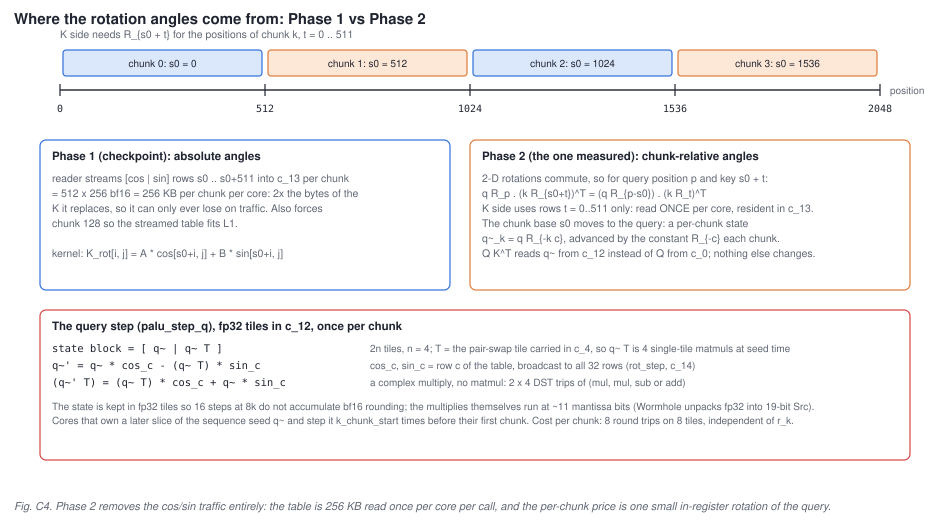

**Phase 1** is the direct version: the reader streams the chunk's absolute `[cos | sin]` rows (512 x 256 bf16,
256 KB) into `c_13` per chunk. That is twice the bytes of the K it replaces, so it can never win on traffic, and
the table forces the chunk down to 128 to fit L1. It exists as a checkpoint and a reference.

**Phase 2** uses the relative-position property of rotary embeddings. Two-dimensional rotations commute, so for a
query at position `p` and a key at position `s0 + t` inside a chunk starting at `s0`:

```
q R_p . (k R_{s0 + t})^T  =  (q R_{p - s0}) . (k R_t)^T
```

The K side therefore only ever needs the angles `t = 0 .. 511`: the first 512 rows of the table, read **once per
core** and resident in `c_13` for the whole call. The chunk base moves to the query: the kernel keeps a rotated
query state `q~_k = q R_{-k c}` and advances it by the constant rotation `R_{-c}` once per chunk. The QK matmul
reads its first operand from that state (`c_12`) instead of from `c_0`; nothing else changes.

The state is kept as `[q~ | q~ T]` in fp32 tiles (`palu_init_q_state` seeds it from Q with four single-tile
matmuls against the `T` tile that rides in `c_4`). Keeping `q~ T` next to `q~` turns the per-chunk rotation into a
complex multiply with no matmul at all (`palu_step_q`):

```
q~'     = q~ * cos_c - (q~ T) * sin_c
(q~' T) = (q~ T) * cos_c + q~ * sin_c
```

where `cos_c`, `sin_c` is table row `c` broadcast to all 32 rows (`rot_step`, `c_14`). That is eight round trips on
eight tiles per chunk, independent of `r_k`. The state is fp32 so that 16 steps at 8k do not accumulate bf16
rounding; the multiplies themselves run at about 11 mantissa bits because Wormhole unpacks fp32 into 19-bit
source registers, which is why the measured drift, not the tile format, is what the stage 2 tests checked. A core
that owns a later slice of the sequence seeds the state and steps it `k_chunk_start` times before its first chunk.
Phase 2 is a compile-time define (`PALU_PHASE2`), selected by passing `rot_step` and `trans_mat` to the op, and it
is the only variant the results are based on.

### C5. Grouped latents: in-kernel V and the group-shared loop

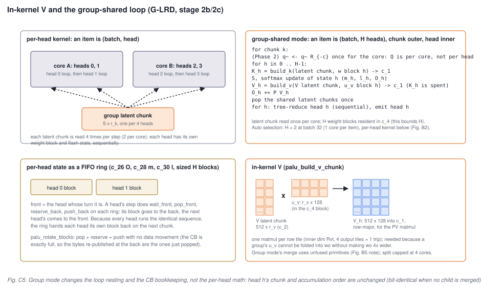

G-LRD (stage 2b) shares one latent among the 4 KV heads of a chip. Two things follow.

**In-kernel V** (`palu_build_v_chunk`). A group's `u_v` cannot be folded into the output projection, so V is
rebuilt per head: the V latent chunk (512 x `r_v`) times this head's `u_v` slice (`r_v` x 128, carried in the same
`c_4` block as `w_rot`), one matmul per row tile with four output tiles, packed row-major into `c_1`, which is
free by then because the QK matmul has consumed `K_rot`. The PV matmul then reads `c_1` instead of `c_2`. This is
the `PALU_RECON_V` define.

**Group-shared mode** (`PALU_GROUP_SHARED`, stage 2c). In the per-head kernel a work item is (batch row, head)
and each head on a core runs the whole chunk loop by itself, so the four heads of a group read every latent chunk
four times. Group mode makes the item (batch row, `H` heads), swaps the loop nesting to chunk-outer, head-inner,
reads each latent chunk once, and lets each head rebuild its own K and V from it with its own resident weight
block; `c_4` holds `H` blocks, which is what bounds `H` (the host picks it per layer from an L1 model:
`H = 2` at batch 32, the per-head kernel below that). Q and the Phase 2 query state are per core, exactly as in
stock, so they are shared by the `H` heads for free.

The interesting mechanism is how per-head flash state survives the loop swap without new CB slots. The three
CBs that must persist across chunks (`c_26` for O, `c_28` for m, `c_30` for l) are sized `H` blocks and used as
rings: because every head performs the identical wait/pop/reserve/push sequence per chunk, the ring hands head
`h` its own block back at the front on the next chunk. Two stock helpers rotate a block to the back mid-step
(`mul_block_inplace`, `mul_block_bcast_cols`); after those the kernel closes the ring with `palu_rotate_blocks`,
a pop-reserve-push with no data movement (the CB is exactly full, so the bytes re-published at the back are the
ones just popped). The per-head math, chunk order and accumulation order are untouched, so a head's output is
bit-identical to the per-head kernel's whenever no cross-core merge is involved.

The cross-core merge is where group mode differs, and it produced two of the study's kernel findings. First, the
reduction runs per head, sequentially: head 0's `(O, m, l)` is peeled out of the rings, merged with the children's
head-0 payloads, emitted, and only then head 1's, because the writer's protocol is "receive head `h`, then send or
write head `h`" and any other order deadlocks against a single-block payload CB. `c_19` gets one slot per (head,
round) and the child bumps the round's semaphore nibble once per head. Second, `correction_block` (B5) stages five
operands in DST, and under fp32 accumulation the window is four; in the group branch that silently returned the
local max as the merged max and dropped the child's contribution (PCC 0.33). Widening the window to eight
(`dst_full_sync_en`, or dropping fp32 accumulation in Phase 1) restores PCC 0.9999, and the per-head branch
survives the same window for reasons that are not established, so the group branch merges with the unfused
primitives instead: `max_block`, two `sub_exp_block`, two `mul_block_inplace`, `add_block_inplace`. That is the
same arithmetic with six extra bf16 packs, which is why group-mode output is only bit-identical when no child is
merged. A three-round tree (8 cores per item) deadlocks in group mode for reasons that were not found; the split is
capped at 4 cores per item.

### C6. Why the fused op is still 1.36x the stock op, and what would change it

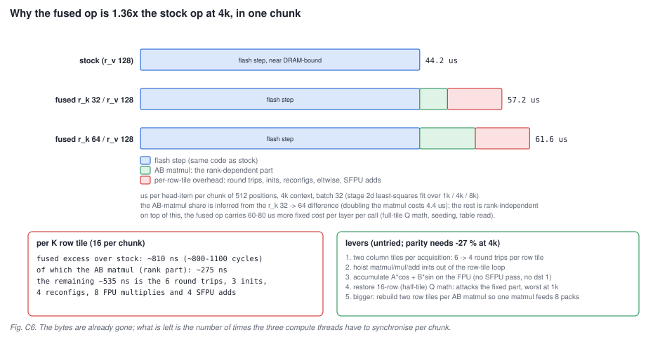

The stage 2d profile fitted per-layer time as `fixed + chunks x per-chunk` for stock and three fused shapes:

| per layer at batch 32 | fixed | per chunk | per item per chunk |
|---|---|---|---|
| stock, `r_v` 128 | 47.7 us | 88.4 us | 44.2 us |
| fused `r_k` 32 / `r_v` 64 | 115.9 us | 112.2 us | 56.1 us |
| fused `r_k` 32 / `r_v` 128 | 118.1 us | 114.3 us | 57.2 us |
| fused `r_k` 64 / `r_v` 128 | 129.5 us | 123.1 us | 61.6 us |

Read against Part C, the excess decomposes cleanly:

- **Per chunk: about 13 us per item, i.e. about 810 ns per K row tile.** Doubling `r_k` (a second inner tile in the
  `AB` matmul, twice the latent bytes) adds only 275 ns of that, so two thirds of the per-row-tile cost is work that
  does not depend on rank: the six round trips, the three inits, the four reconfigurations, the eight FPU multiplies
  and the four SFPU adds of C3. The DRAM bytes were never the problem; the fused op reads 0.63x stock's bytes at
  4k and runs at 22 to 42 % of the roofline where stock runs at 77 %.
- **Per call: 60 to 80 us more fixed cost per layer**, which is why the ratio is worst at 1k (1.55x, two chunks)
  and improves toward 8k (1.33x, sixteen chunks). The candidates are per-call work the profile cannot separate:
  full-tile Q math where stock uses half tiles, the 256 KB table read per core, and seeding the query state.
- **The rank barely matters**: ratio 0.5 and 0.7 differ by 2 to 3 % in the whole step, and the only visible rank
  cost is `r_k` 64 layers at +8 % per layer.

Parity with stock needs the fused op to lose about 27 % at 4k (36 % at 1k). The levers are exactly the
overheads C3 counts, none of them tried yet:

1. Two column tiles per acquisition in the rotation loop: six round trips per row tile become four.
2. Hoist `matmul_block_init`, `mul_init` and `add_binary_tile_init` out of the row-tile loop; only the format
   reconfigurations genuinely have to be per tile.
3. Accumulate `A cos + B sin` on the FPU instead of through a second DST tile and an SFPU pass.
4. Restore 16-row (half-tile) Q math in the copied op, which attacks the fixed part that dominates at 1k.
5. Rebuild two row tiles per `AB` matmul so one acquisition feeds eight packs.

Whole-step decode reproduces to 0.1 %, so each lever can be measured on its own.

---

## Glossary

| term | meaning here |
|---|---|
| Tensix core | one compute tile of the chip: five RISC-V dispatchers, 1.5 MB L1, an FPU, an SFPU, two NoC ports |
| BRISC / NCRISC | the two data-movement RISC-Vs; they run the reader and writer kernels |
| TRISC 0 / 1 / 2 | the three compute RISC-Vs: unpack, math, pack; one compute source compiled three times |
| L1 | the core's 1.5 MB SRAM; addressable chip-wide as (x, y, offset); no cache semantics |
| NoC | network-on-chip; two of them, carrying asynchronous reads and writes between L1s and DRAM |
| tile | 32 x 32 elements in four 16 x 16 faces; the unit of storage, transfer and compute |
| half tile | 16 x 32 (faces 0 and 1); used by stock decode for Q-side operands with 16 or fewer query heads |
| bf16 / fp32 / bfp8_b | tile formats: 2048 / 4096 / 1088 bytes per tile; bfp8 shares one exponent per 16 elements |
| CB, `c_N` | circular buffer: a fixed L1 FIFO of pages with one producer and one consumer; 32 slots per core |
| reserve_back / push_back | producer side of a CB; wait_front / pop_front is the consumer side |
| SrcA / SrcB | the FPU's two input registers, filled by the unpacker from CBs |
| FPU | the matrix engine: matmul, reduce, element-wise add / sub / mul from SrcA and SrcB into DST |
| SFPU | the 32-lane vector engine: exp, reciprocal, adds, operating on tiles already in DST |
| DST | the accumulator register file: 16 x 16-bit tiles or 8 x fp32; 4 usable per step here |
| dst_size | the factory's per-acquisition budget: `fp32_dest_acc_en ? 4 : 8` |
| round trip | `tile_regs_acquire .. commit .. wait .. pack .. release`: one unit of compute work |
| math fidelity | how many 5 x 7-bit passes the FPU makes per multiply; HiFi2 = 2 here |
| fp32 dest acc | keep DST in fp32 so matmul inner sums do not round; halves the DST tiles per step |
| semaphore | a 32-bit L1 word incremented over the NoC and polled locally; the cross-core signal |
| program factory | host code that lays out cores, sizes CBs and passes compile-time and runtime arguments |
| work item | one (batch row, KV head) in stock and per-head Palu; one (batch row, H heads) in group mode |
| chunk, `Sk_chunk_t` | 512 positions = 16 row tiles of K and V processed per flash step |
| m, l, O | the online-softmax state: running max, running sum, unnormalised output |
| tree reduction | the log2 N-round merge of partial (O, m, l) across the cores of one item |
| latent, `r_k`, `r_v` | Palu's narrow K and V caches and their widths (32 / 64 / 96 and up to 128 here) |
| `w_rot`, `u_v`, `T` | per-head `[u_k \| u_k T]`, the V up-projection, and RoPE's pair-swap tile |
| Phase 1 / Phase 2 | streamed absolute angles vs resident chunk-relative angles plus a rotated query state |
| M-LRD / G-LRD | per-head latents vs latents shared by a group of 4 KV heads |
| group-shared mode | the stage 2c variant: chunk-outer, head-inner loop with per-head state rings |

## Where the code is

| what | file |
|---|---|
| stock compute kernel | `ttnn/cpp/ttnn/operations/transformer/sdpa_decode/device/kernels/compute/sdpa_flash_decode.cpp` |
| stock reader / writer | `.../sdpa_decode/device/kernels/dataflow/reader_decode_all.cpp`, `writer_decode_all.cpp`, `dataflow_common.hpp` |
| shared compute helpers (`matmul_blocks`, `reduce_c`, `sub_exp_*`, `correction_block`, ...) | `ttnn/cpp/ttnn/operations/transformer/sdpa/device/kernels/compute/compute_common.hpp` |
| stock program factory and tree parameters | `.../sdpa_decode/device/sdpa_decode_program_factory.cpp`, `sdpa_decode_device_operation.hpp` |
| chunk assignment per core | `.../sdpa_decode/device/kernels/rt_args_common.hpp` (`get_workload_for_core`) |
| DST capacity rules | `ttnn/cpp/ttnn/kernel_lib/dest_helpers.hpp` |
| Palu compute kernel and helpers | `.../palu_sdpa_decode/device/kernels/compute/palu_sdpa_flash_decode.cpp`, `palu_compute_common.hpp` |
| Palu reader / writer | `.../palu_sdpa_decode/device/kernels/dataflow/palu_reader_decode.cpp`, `palu_writer_decode.cpp`, `palu_dataflow_common.hpp` |
| Palu program factory (CB sizes, group mode, caps) | `.../palu_sdpa_decode/device/palu_sdpa_decode_program_factory.cpp` |
| host side: chunk rule, tables, L1 model, H selector | `palu_tt/fused.py`, `palu_tt/attention.py` (this repository) |
| the numbers quoted in C6 | `docs/results/stage2d.md`; kernel findings in `docs/results/stage2c.md` section 6 |
| tt-metal background | `METALIUM_GUIDE.md`, `tech_reports/FlashAttention/FlashDecode.md`, `tech_reports/matrix_engine/matrix_engine.md` |

The figures are generated by `scripts/kernel_figures.py` into `docs/figures/`.
