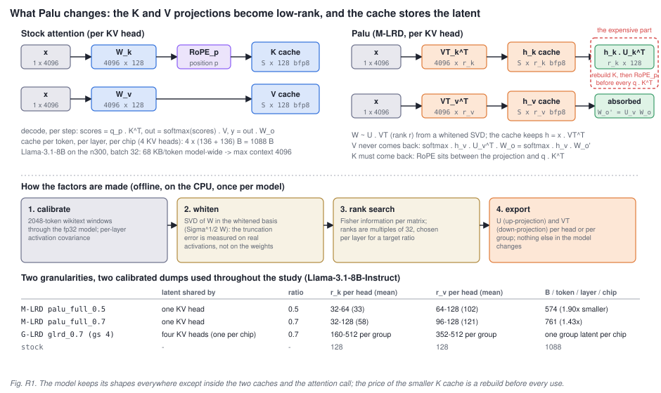
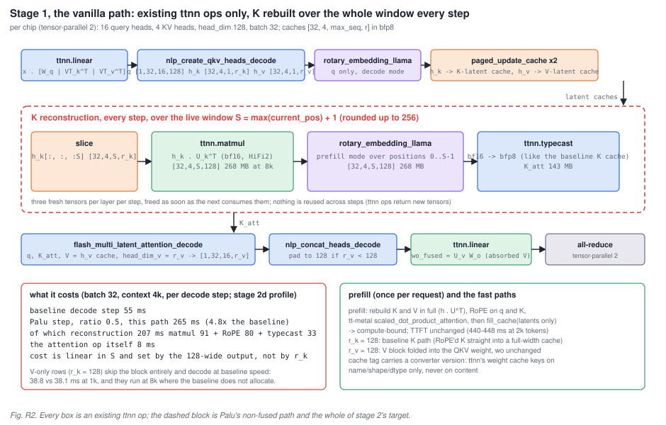
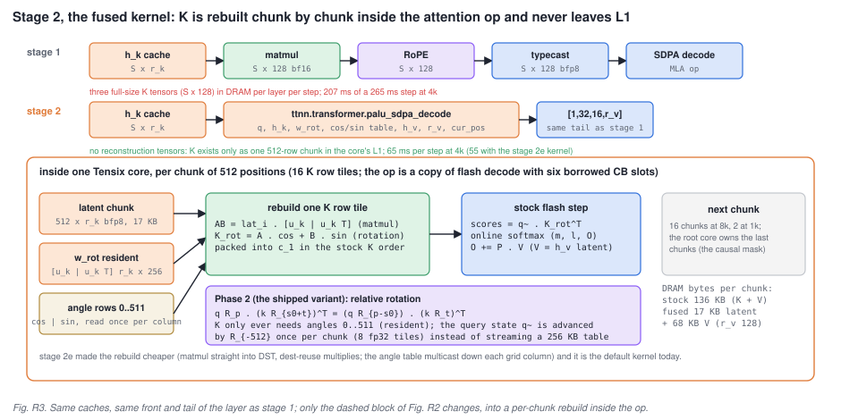
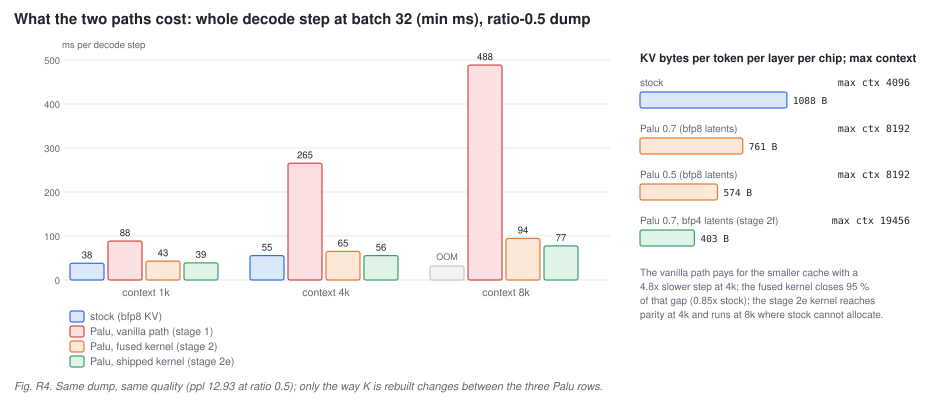

# Palu on Tenstorrent: what changes in the model, and how it runs on the n300

This report covers three things: what Palu does to a Llama attention layer, how that modified layer was made to run on a Tenstorrent Wormhole n300 with nothing but existing ttnn ops (the vanilla path, stage 1 of the study), and how a fused tt-metal kernel then removed the cost that the vanilla path could not (stage 2). Every number is a measurement from this study on Llama-3.1-8B-Instruct, tensor-parallel 2 across the n300's two chips, tt-metal v0.78.0 with the study's `palu-sdpa` branch; the raw JSONs and the per-stage documents are in `docs/results/`.

## 1. Setup

Everything below was measured with one harness on one board, so the rows are comparable with each other; they are not comparable with published numbers taken under other protocols.

- **Model.** `meta-llama/Llama-3.1-8B-Instruct`: 32 layers, 32 query heads, 8 KV heads, head dimension 128, hidden size 4096. Weights come from the Hugging Face checkpoint unchanged.
- **Hardware and stack.** One Tenstorrent Wormhole n300 (two chips, tensor-parallel 2, so each chip owns 16 query heads and 4 KV heads), Intel i7-14700 host, Ubuntu 22.04. tt-metal v0.78.0 built from source, with the study's `palu-sdpa` branch for the fused op; the model runs through tt-metal's own `tt_transformers` implementation. Weights and KV caches in bfp8 (block floating point, 8-bit mantissa, 1.0625 B per element), activations in bf16, non-paged caches, untraced decode, and the same attention plumbing (`use_qk_fused=False`) for every row.
- **The baseline.** "Baseline" throughout means the unmodified model running through `tt_transformers`' own attention, with its full-width bfp8 K and V caches. Every Palu row replaces only the attention module.
- **The Palu factorisations.** Produced with Palu's reference implementation (`third_party/palu`, `compress.py`) on the host CPU in fp32: whitened decomposition (`whiten`), Fisher-information uniform rank search (`fisher_uniform`), wikitext-2 calibration sequences of 1024 tokens, 32 Fisher samples for the per-head dumps and 256 for the grouped dump, ranks in multiples of 32. Two per-head dumps (M-LRD, group size 1) at target ratios 0.5 and 0.7, and one grouped dump (G-LRD, group size 4, one group per chip) at 0.7. The whitening runs in float64; in float32 the first two layers do not invert.
- **Quality.** Perplexity on the wikitext-2 test split: 141 non-overlapping windows of 2048 tokens (288,627 scored tokens), scored on the device through the prefill path; the final norm, the LM head and the cross-entropy run on the host in fp32. Task accuracy: lm-eval 0.4.2, zero-shot, five tasks (ARC-easy, ARC-challenge, PIQA, OpenBookQA, WinoGrande), through the same prefill path, about 52 minutes per row on the device. Decode fidelity: teacher-forced decoding over 63 steps, reporting the minimum and mean logit PCC and the argmax agreement of the fused path against the vanilla path, and of both against an fp32 CPU implementation of the same low-rank model.
- **Speed.** Whole decode step at batch 32 with `max_seq_len` equal to the context (1k, 4k, 8k): 3 warm-up and 20 timed iterations, device sync inside the timed region; the minimum is reported (the median is within 1 % of it on an idle host, and every run was gated on the board being idle). Time to first token at batch 1. Per-op device times come from tt-metal's Tracy profiler (stage 2d): 3 warm-up and 3 profiled steps per configuration.
- **Capacity.** The largest `max_seq_len` at which the model allocates at batch 32, found by bisection; KV bytes per token are computed from the allocated caches and cross-checked against the device memory report.

## 2. Why the KV cache is the problem on the n300

Decode is memory-bound. At batch 32 a decode step of this model takes about 55 ms at 4k context, and roughly 30 ms of that is weight streaming that no cache trick can touch (MLP 12 ms, collectives 10 ms, the projections and the LM head 4.5 ms). What scales with context is the attention op: it reads the whole KV cache of every user every step. The baseline keeps K and V in bfp8, so one token costs 1088 bytes per layer per chip (4 KV heads x 128 x 1.0625 B, twice) and 68 KB across the model. At 4k context and batch 32 that is 4.6 GB of cache traffic per step, which at the chip's ~240 GB/s is the 24 ms the baseline's attention op measures. The same bytes bound capacity: the baseline allocates at most 4096 tokens of context at batch 32 on this board.

Halving the cache therefore does two things at once, both worth having: fewer bytes per step, and more context or more users in the same DRAM. Palu is a way to halve it without touching the model's weights, activations or shapes anywhere except inside the cache and the attention call.

## 3. What Palu changes in the model

**The factorisation.** In every attention layer only two matrices change, the key and value projections. For each KV head (or group of heads) the weight slice `W` (4096 x 128) is written as a product of two thin matrices, `W ~ U . VT`, with an inner rank `r` smaller than the head dimension. What the cache stores is no longer the projected key or value but the r-dimensional **latent** `h = x . VT^T`; the second factor is applied later. Nothing else in the layer moves: the query projection, RoPE, the softmax and the output projection keep their shapes, and the model outside attention is untouched.

**V is free, K is not.** For values the second factor can be folded away. Attention computes `softmax(scores) . V` and then multiplies by the output projection; with `V = h_v . U_v^T` that is `softmax . h_v . (U_v^T W_o)`, so the up-projection `U_v` is absorbed into the output weight once, offline (`W_o' = U_v W_o`), and V is never reconstructed at all. The attention op simply consumes an `r_v`-wide value tensor and produces an `r_v`-wide output.

Keys cannot be treated the same way, because rotary position embedding sits between the projection and the dot product with the query: the cached quantity is `RoPE_p(x W_k)`, and RoPE is applied per position after the projection. A latent `h_k` therefore has to be brought back to 128 dimensions **and** rotated by its position's angle before every `q . K^T`. That rebuild is the entire cost of Palu at decode time, and the whole of stage 2 (section 5) is about where it happens.

**Granularity.** Palu names three granularities. M-LRD gives every KV head its own factorisation and latent; G-LRD lets a group of heads share one latent (group size 4 here: the four KV heads a chip owns share one `r_k`-wide and one `r_v`-wide latent); J-LRD would share across all heads and was not used. The study measured M-LRD at two compression ratios and G-LRD at the same two.

**How the factors are made.** A plain truncated SVD of the weights is not enough: at rank 64 per head it takes the model from perplexity 7.25 to 704, at rank 96 to 79. Palu's recipe fixes that in two steps, both offline on the CPU. First, whitening: activations from wikitext-2 calibration sequences give a per-layer covariance, and the SVD is taken in the whitened basis, so the truncation error is measured on the activations the layer actually sees rather than on the raw weights (the whitening has to be done in float64; the first two layers are conditioned at ~1e16). Second, a rank search: Fisher information per matrix decides how much rank each layer's K and V get for a target ratio, in multiples of 32. The result is per-layer ranks, exported as `U` and `VT` per head or per group, and nothing else.

**The two dumps used throughout.** At ratio 0.5 (`palu_full_0.5`) the search puts K at rank 32 in most layers (mean 33) and V at 64 to 128 (mean 102): 574 bytes per token per layer per chip, 1.90x smaller than the baseline. At ratio 0.7 (`palu_full_0.7`) K averages 58 and V 121: 761 bytes, 1.43x smaller. The search prefers to spend rank on V, and stage 2f later confirmed why: at equal bytes perplexity is far more sensitive to the V rank than to the K rank.

**What it costs in quality.** Measured on the device over 141 wikitext windows, the baseline is 7.25; ratio 0.7 is 9.03 and ratio 0.5 is 12.93 (Palu's own paper reports 8.28 -> 12.38 for Llama-3-8B-Instruct at 50 %, so the ratio-0.5 point is in line). On five zero-shot tasks the average drops from 65.4 to 61.5 (0.7) and 55.8 (0.5). Grouped latents are kinder: G-LRD at 0.7 with a 256-sample calibration reaches perplexity 8.14 and 64.5 on the tasks, within a point of the baseline on the tasks and within a quarter point of the paper's own G-LRD number. The identity factorisation (rank 128, `U = I`) reproduces the baseline to three decimals (7.255 vs 7.254, 32 of 32 greedy tokens identical), which is how the port itself was validated.

## 4. Running it on Tenstorrent the vanilla way (stage 1)

**Where it plugs in.** tt_transformers builds the model per chip; with tensor-parallel 2 each chip owns 16 query heads and 4 KV heads of head dimension 128, and the two chips all-reduce after the output projection. The study replaces the attention module with a `PaluAttention` that keeps every original shape and op outside the two caches and the attention call. The weights are converted once: the K and V down-projections `VT^T` replace the K and V blocks of the fused QKV weight (so one `ttnn.linear` yields the query and both latents for the new token), the K up-projection `U_k` becomes a per-head device tensor, and the V up-projection is folded into the output weight `wo_fused = U_v W_o`. Because ttnn's on-disk weight cache keys only on a tensor's name, shape and dtype, never its content, every Palu cache entry carries a converter version and a weight-set id; that version has been bumped three times, each time because a tensor's content changed under an unchanged name.

**Prefill.** Once per request the layer projects the whole prompt, reconstructs K and V in full (`h . U^T`), applies RoPE to q and K, and runs tt-metal's scaled-dot-product attention at head dimension 128; only the latents are written to the caches (`fill_cache`). Prefill is compute-bound, so the reconstruction is cheap there and time-to-first-token is unchanged (440 to 448 ms at 2k tokens across every row). The prefill path is also where perplexity and task accuracy are scored, which matters later: until stage 2f the score never saw the cache's number format.

**Decode, per layer, per step.** The front of the step is the baseline's own: `ttnn.linear` on the fused weight, `nlp_create_qkv_heads_decode` to split heads, RoPE on the query in decode mode, and two `paged_update_cache` writes that put the new token's `h_k` and `h_v` into caches of shape `[32, 4, max_seq, r]` in bfp8. Then comes Palu's non-fused path, the dashed block of Fig. R2: slice the K latent cache to the live window `S` (rounded up to 256 so the op shapes do not change every token), multiply by `U_k` on the device (bf16, HiFi2) into a `[32, 4, S, 128]` tensor, rotate it with the prefill-mode RoPE op over positions 0 to S-1, and typecast it to bfp8 so that it looks exactly like the baseline's K cache. That tensor goes into `flash_multi_latent_attention_decode` together with the V latent cache as V (the op accepts a narrower V, `head_dim_v = r_v`), and the tail is the baseline's again: concatenate heads, `wo_fused`, all-reduce. ttnn ops return new tensors rather than writing into caller-owned ones, so the block allocates three fresh full-size K tensors per layer per step (268 + 268 + 143 MB at 8k) and frees them before the next layer.

**Two fast paths** keep uncompressed sides honest. A head with `r_k = 128` is not compressed, so it takes the baseline's K path: RoPE'd K written straight into a full-width cache, no rebuild. A head with `r_v = 128` folds its V block into the QKV weight and leaves `W_o` alone; doing that correctly required `U_v = I`, and getting it wrong cost two days and perplexities in the thousands before the converter enforced it.

**What it measured.** Correctness first: the identity row reproduces the baseline, and every compressed row agrees with an fp32 CPU implementation of the same low-rank model (prefill logit PCC 0.99+; the `r = 64` gap of 0.963 sits in the bf16 reconstruction matmul, not the cache dtype). Capacity next, and this benefit is real on day one: every compressed row allocates 8192 tokens of context at batch 32 where the baseline stops at 4096, and at batch 8 the ratio-0.5 dump reaches 48k tokens against the baseline's 28k. Speed is where the vanilla path fails. V-only compression is free (38.8 vs 38.1 ms at 1k), because V never comes back. Any row that reconstructs K is 2.3 to 9x slower than the baseline: the ratio-0.5 dump takes 88 ms at 1k, 265 ms at 4k and 488 ms at 8k, against the baseline's 38 and 55 ms. The stage 2d profile put numbers on why: at 4k the reconstruction block costs 207 ms of the 265 ms step (matmul 91, RoPE 80, typecast 33) while the attention op itself is 8 ms. The cost is linear in the window and set by the 128-wide output that has to be written three times, not by the rank; halving `r_k` changes almost nothing.

That is the state the vanilla port leaves you in: the memory win is banked, the speed is worse than the model it compresses, and the reason is a rebuild of the full K tensor in DRAM before every attention call.

## 5. The fused kernel (stage 2)

**The idea.** Flash decode already streams K through a core in chunks of 512 positions and never holds the whole cache at once. If the rebuild happens inside that loop, chunk by chunk, the full K never exists anywhere: each core reads its 17 KB slice of the latent, rebuilds and rotates a 512 x 128 chunk into its own L1 in the layout flash decode's QK matmul expects, and the rest of the flash step runs unchanged. No reconstruction tensors, no extra DRAM round trip, and the bytes read per chunk drop from 136 KB (baseline K + V) to 17 KB of latent plus the V latent.

**The op.** `ttnn.transformer.palu_sdpa_decode` is a verbatim copy of tt-metal's flash-decode op with a narrower envelope (causal, unpaged, no mask tensor, no attention sink, no sliding window) and six circular-buffer slots borrowed from the features it drops: one for the latent chunk, one for the resident rotation weights, one for the angle table, one for the rebuilt K chunk in bf16, and two for the Phase 2 state described below. Its inputs are the query, the K latent cache, the V latent cache, the per-head rotation weight and the angle table; its output is the same `r_v`-wide tensor the vanilla path produced, so the layer's tail is unchanged. The per-core work split, the online softmax and the tree reduction across cores are tt-metal's flash-decode code, unchanged.

**Rebuilding a chunk.** tt-metal's RoPE op writes `out = x * cos + (x T) * sin`, with `T` a fixed pair-swap matrix. Since `(h U_k) T = h (U_k T)`, the host packs `w_rot = [U_k | U_k T]` once per head, and a single matmul of a latent row tile against it gives both halves, `A = h U_k` and `B = h U_k T`; the rotated tile is then `A . cos + B . sin`, packed into the K buffer in column-major tile order. Sixteen row tiles per chunk, and the unchanged flash-decode step follows.

**Where the angles come from.** The direct version streams each chunk's absolute cos/sin rows into the core, 256 KB per chunk, which is twice the bytes of the K it replaces and can never win; it exists as a checkpoint (Phase 1). The shipped version (Phase 2) uses the relative-position property of rotary embeddings: `q R_p . (k R_{s0+t})^T = (q R_{p-s0}) . (k R_t)^T`, so the K side only ever needs the angles for offsets 0 to 511, read once per core and kept resident, while the query is advanced by the constant rotation `R_{-512}` once per chunk. Keeping the query state as `[q~ | q~ T]` in fp32 turns that step into eight elementwise multiplies with no matmul at all. Stage 2e later had one core per grid column read the table and multicast it, which took ~61 us of fixed cost per layer off the op.

**Correctness.** The fused op matches the vanilla path to PCC 0.9998 at the op level and 0.9997 at the attention-module level; the caches it writes are byte-identical; teacher-forced decoding over 63 steps agrees with the vanilla path at logit PCC 0.998 or better on both calibrated dumps, and the perplexity is unchanged by construction (prefill does not use the op).

**Speed.** With the fused op the ratio-0.5 dump decodes in 42.8 / 65.0 / 94.5 ms at 1k / 4k / 8k against the baseline's 38.0 / 55.4 / OOM: 0.89x and 0.85x of the baseline at 1k and 4k, 2.1 to 5.2x faster than the vanilla path, and still running at 8k where the baseline does not allocate. At 8k and batch 32 that is 339 tokens per second where the baseline tops out at batch 16 and 290. The ratio-0.7 dump is within 3 % of the same numbers: the rank barely matters once the rebuild is in L1. The remaining gap to the baseline was profiled in stage 2d: the fused op reads 0.63x the baseline's bytes but runs at 22 to 42 % of the bandwidth roofline where the baseline's op runs at 77 %, because the rebuild adds about a hundred DST register round trips per chunk to a flash step that needs about 24. That is overhead per K row tile, not bytes and not rank, and it is exactly what stage 2e removed: a rotation that multiplies straight out of the matmul's destination register, plus the multicast table, take the whole step to 39.0 / 55.5 / 77.4 ms. The fused op's fitted cost per chunk (85.8 us per layer) is now below the baseline op's (88.5), and the 1 ms that remains at 1k is the Palu path's layout ops around the attention call, not the kernel.

## 6. The three ways to run the same model, side by side

| | KV bytes per token per layer per chip | max context at batch 32 | decode step 1k / 4k / 8k, ms | wikitext ppl |
|---|---|---|---|---|
| baseline: unmodified model, tt_transformers attention (bfp8 KV) | 1088 | 4096 | 38.0 / 55.4 / OOM | 7.25 |
| Palu 0.5, vanilla path (stage 1) | 574 | 8192 | 88.5 / 265.3 / 488.5 | 12.93 |
| Palu 0.5, fused kernel (stage 2) | 574 | 8192 | 42.8 / 65.0 / 94.5 | 12.93 |
| Palu 0.5, shipped kernel (stage 2e) | 574 | 8192 | 39.0 / 55.5 / 77.4 | 12.93 |
| Palu 0.7, shipped kernel | 761 | 8192 | 39.4 / 57.0 / 80.6 | 9.03 |

The model's quality is fixed by the offline factorisation; the three Palu rows differ only in where K is rebuilt. Rebuilding it in DRAM with generic ops costs 4.8x at 4k; rebuilding it inside the attention op costs 15 %; rebuilding it with the rotation fused into the matmul's register file costs nothing measurable. Stage 2f then went after the bytes themselves: with the V latent stored in bfp4 the ratio-0.7 dump runs at 32 KB per token (2.1x smaller than the baseline), decodes at baseline parity, and holds 3.5x the context, for a perplexity of 9.24.

## Where to read more

- `docs/kernel_guide.md`: the Tensix core, flash decode as written, and the fused kernel function by function (fifteen figures).
- `docs/results/stage1.md` and `stage2.md`: the two stages this report summarises, with every row and the caveats.
- `docs/results/stage2b.md`, `stage2c.md`: grouped latents (G-LRD) and the shared-latent group kernel.
- `docs/results/stage2d.md`, `stage2e.md`, `stage2f.md`: the decode profile, the kernel variants that reached parity, and the rank/format frontier.
- The Palu paper: Chang et al., "Palu: Compressing KV-Cache with Low-Rank Projection" (2024); `third_party/palu` is its reference implementation, used unchanged for the offline factorisation.
