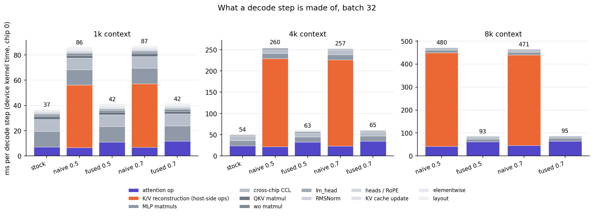
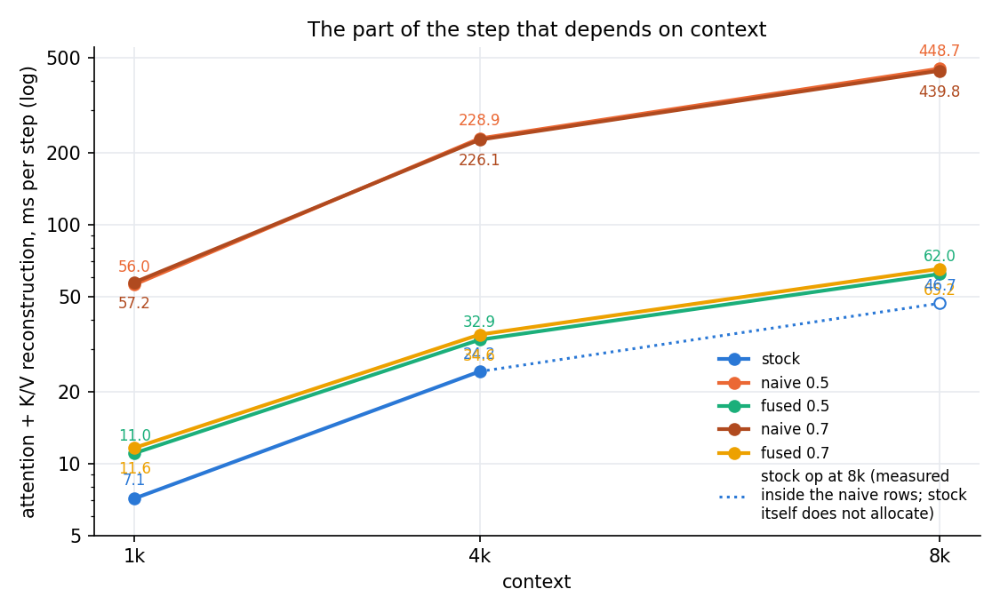
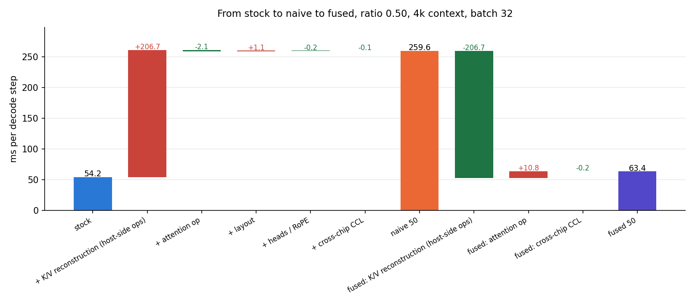
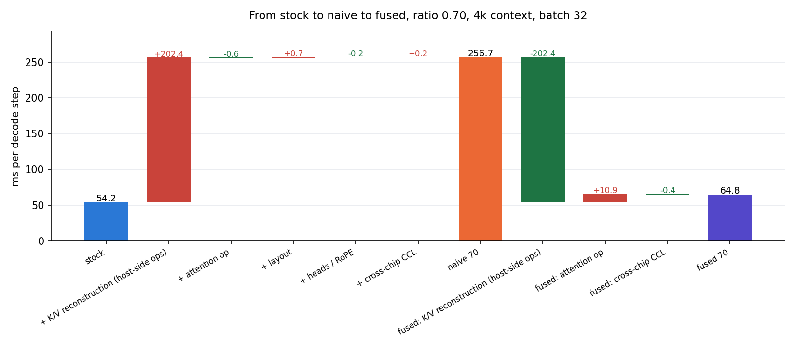
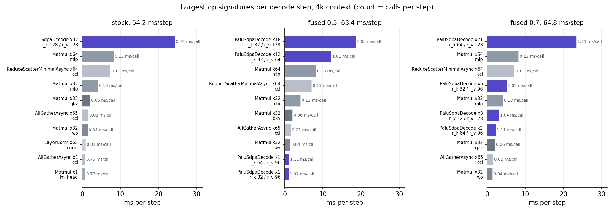

# Stage 2d: where a decode step actually goes — stock vs naive Palu vs the fused kernel

Hand-written (this stage has no renderer). Every number below comes from one of the fourteen
`docs/results/raw/profile_<row>_<ctx>.json` files, or is arithmetic on them that is shown in place;
the wall-clock comparisons come from `docs/results/raw/bench_decode_<row>.json`, and the per-layer
ranks from `compressed/palu_full_0.{5,7}/config.json`. Figures are rendered by
`python -m palu_tt.profile_plots` from the same JSONs. Nothing here is estimated unless it says so.

This stage supersedes stage 2's "where the time goes" discussion, which rested on a **layer-0
attention-only microbench**; what follows is a whole-model, per-op device profile of the real decode
step, so it can say what fraction of the step each op is, not just how one layer's attention behaves.

---

## 0. How to read this

**What was measured.** `palu_tt/profile_decode.py` builds the same model `palu_tt.bench` builds
(Llama-3.1-8B-Instruct, TP=2 over the two chips of one Wormhole n300, batch 32, bfp8 weights and
caches, non-paged, untraced, decode at the last position of the given context), runs 3 warm-up decode
steps to get past JIT and fill the program cache, drops the device profiler buffers, then brackets
**3 profiled decode steps** between tracy `start` / `stop` signposts, flushing the device profiler
after each one so the on-device buffers cannot overflow.

`palu_tt/profile_report.py` reads the ops CSV, keeps the rows between the two signposts, takes
**device 0**, divides by 3, classifies every op into one of thirteen categories (the rules are in the
module docstring) and writes the JSON. Chip 1 runs the same program and is reported as a check: it
agrees with chip 0 to **0.034 % or better on all fourteen runs** (worst: `palu_full_70_1024`,
0.0335 %), so "chip 0" and "the device" are interchangeable below.

**What "device ms" means.** It is the **sum of `DEVICE KERNEL DURATION` over every op in one step** —
what the device is busy computing. It excludes the gaps between ops (host dispatch), so it is a lower
bound on the step. The untraced wall-clock step from the separate, unprofiled `bench` runs is
**1.7–3.3 % higher**:

| row | ctx | device ms/step | bench `min_ms` | wall / device |
|---|---|---|---|---|
| baseline | 1024 | 37.06 | 38.00 | 1.025 |
| baseline | 4096 | 54.17 | 55.39 | 1.022 |
| palu_full_50 | 4096 | 259.61 | 265.34 | 1.022 |
| palu_full_50 | 8192 | 480.37 | 488.46 | 1.017 |
| palu_full_50_fk2 | 1024 | 41.61 | 42.83 | 1.029 |
| palu_full_50_fk2 | 4096 | 63.45 | 64.97 | 1.024 |
| palu_full_50_fk2 | 8192 | 92.62 | 94.48 | 1.020 |
| palu_full_70_fk2 | 4096 | 64.79 | 66.36 | 1.024 |
| palu_full_70_fk2 | 8192 | 95.43 | 97.72 | 1.024 |

(the full fourteen are in the JSONs; the ratio is between 1.017 and 1.033 everywhere).

Two things follow. First, **the step is device-bound**: at most 3.3 % of it is dispatch bubbles, so
optimising the ops is the whole game and the untraced-vs-traced question stage 2 left open is worth
at most ~1.5 ms at 4k. Second, **the profiler is not visibly perturbing the kernels**: a profiled
kernel that ran slow would push the device sum *up*, and the sum comes in consistently *below* an
independently measured wall clock by a small, stable margin. That is an argument, not a measurement —
the same model was not benched with and without the profiler.

**A note on precision.** Three steps is enough because the per-op numbers are extremely repeatable
(the same op signature at the same shape lands within 0.003 ms of itself across rows — e.g. the MLP
category is 12.322–12.333 ms in all fourteen runs), but it means there is **no run-to-run error bar**
in this stage. Differences below ~0.05 ms per step should not be read.

**The roofline used below.** Wormhole n300 is 24 GB of GDDR6 at ~576 GB/s across two chips, i.e.
**~288 GB/s per chip** — a datasheet figure, not measured here. Rather than lean on it, most
comparisons below use an **in-situ roofline of 243 GB/s**: the rate the MLP matmuls actually achieve
in these same profiles (§1). Percentages quoted as "% of roofline" are against 243 GB/s.

---

## 1. The shape of a decode step: 30 ms that never moves

Device ms per step, split into the attention block (the attention op plus, for the naive rows, the
host-side K/V reconstruction) and everything else:

| row | ctx | total | attention op | k_recon | everything else |
|---|---|---|---|---|---|
| baseline | 1024 | 37.06 | 7.13 | – | **29.93** |
| baseline | 4096 | 54.17 | 24.24 | – | **29.93** |
| palu_full_50 (naive) | 1024 | 86.34 | 6.58 | 49.45 | **30.30** |
| palu_full_50 | 4096 | 259.61 | 22.12 | 206.74 | **30.75** |
| palu_full_50 | 8192 | 480.37 | 42.41 | 406.34 | **31.62** |
| palu_full_50_fk2 (fused) | 1024 | 41.61 | 11.03 | – | **30.58** |
| palu_full_50_fk2 | 4096 | 63.45 | 32.90 | – | **30.55** |
| palu_full_50_fk2 | 8192 | 92.62 | 62.01 | – | **30.61** |
| palu_full_70 (naive) | 1024 | 87.34 | 6.95 | 50.28 | **30.11** |
| palu_full_70 | 4096 | 256.72 | 23.69 | 202.40 | **30.63** |
| palu_full_70 | 8192 | 471.14 | 45.55 | 394.22 | **31.38** |
| palu_full_70_fk2 (fused) | 1024 | 41.83 | 11.62 | – | **30.21** |
| palu_full_70_fk2 | 4096 | 64.79 | 34.59 | – | **30.20** |
| palu_full_70_fk2 | 8192 | 95.43 | 65.20 | – | **30.23** |

**The last column is the headline of this stage.** Across five model variants and three contexts —
a 13x spread in total step time, from 37 to 480 ms — everything outside the attention block is
**29.93 to 31.62 ms**, a spread of 5.6 %. All of the difference between the three decodes is in the
attention block, and nothing any of them does leaks into the rest of the model.

What those 30 ms are (ratio 0.5 and 0.7 columns are the fused rows), at 4k:

| category | stock | naive 0.5 | fused 0.5 | naive 0.7 | fused 0.7 | what it is |
|---|---|---|---|---|---|---|
| mlp | 12.322 | 12.328 | 12.331 | 12.325 | 12.332 | w1 / w3 / w2, 96 matmuls |
| ccl | 9.590 | 9.492 | 9.310 | 9.751 | 9.329 | 64 reduce-scatter + 66 all-gather across the two chips |
| qkv | 2.033 | 2.020 | 2.021 | 2.023 | 2.018 | the fused QKV projection |
| wo | 1.382 | 1.373 | 1.381 | 1.377 | 1.387 | output projection |
| lm_head | 1.090 | 1.091 | 1.091 | 1.090 | 1.091 | vocabulary projection |
| heads | 0.884 | 0.725 | 0.719 | 0.728 | 0.720 | create/concat heads, decode RoPE on q/k |
| elementwise | 0.832 | 0.831 | 0.831 | 0.831 | 0.831 | residual adds, SiLU, embedding |
| norm | 0.819 | 0.812 | 0.809 | 0.811 | 0.808 | 65 RMSNorms |
| cache | 0.605 | 0.587 | 0.582 | 0.652 | 0.643 | KV / latent cache update |
| layout | 0.372 | 1.489 | 1.472 | 1.043 | 1.037 | shard/reshard/typecast/slice |
| **total** | **29.93** | **30.75** | **30.55** | **30.63** | **30.20** | |

The Palu rows pay **+1.10 ms of extra `layout`** (0.372 → 1.47 at ratio 0.5) for slicing and
resharding the two latent caches, get **0.16 ms back on `heads`** (they do not RoPE K in decode mode
— the K rotation moves either into the reconstruction or into the fused kernel), and land 0.3–0.8 ms
above stock in total. `ccl` is the only category with real spread (9.31–10.48 ms across all fourteen
runs, ±6 %); it is a cross-chip synchronisation and picks up whatever skew the rest of the step has,
which is why the naive 8k rows — where the step is 480 ms long — show its highest values.

**Why this part is identical: decode at batch 32 is weight-streaming, and the weights do not change.**
Every row runs the same 8B-parameter model in bfp8; per chip per step the four matmul categories move

| category | weights per chip (bfp8, 1.0625 B/param) | ms | achieved |
|---|---|---|---|
| mlp | 3 × 4096 × 7168 × 32 layers = 2.819 G params → **2.995 GB** | 12.322 | **243 GB/s** |
| qkv | 4096 × 3072 × 32 → 0.428 GB | 2.033 | 210 GB/s |
| wo | 2048 × 4096 × 32 → 0.285 GB | 1.382 | 206 GB/s |
| lm_head | 4096 × 64128 → 0.279 GB | 1.090 | 256 GB/s |
| **all four** | **3.987 GB** | **16.83** | **237 GB/s** |

At 84 % of the n300's ~288 GB/s datasheet bandwidth, these ops are as memory-bound as a decode step
gets: the batch of 32 tokens is far too small to make them compute-bound, so they cost exactly one
pass over the weights regardless of what the attention block does. That is the "30 ms floor", and it
is why **the only lever any KV-compression scheme has on a batch-32 decode step is the attention
block** — and also why compression can never make a step much *faster* than ~30 ms at these contexts.
The 243 GB/s the MLP achieves is used as the in-situ roofline for the rest of this report.

---

## 2. The attention block across five rows and three contexts

Attention + reconstruction, ms per step (log axis in the figure). Stock does not allocate at 8192 at
batch 32, but its op is still measured there: the naive rows run **the stock op on the reconstructed
full-width K**, and its `out`-128 signature costs 1.461 ms per layer at 8k, i.e. **46.8 ms for 32
layers** — a measurement, not an extrapolation (a linear fit through stock's 1k and 4k points
predicts 47.0, which is the same number). The figure shows this as the dotted extension.

| row | 1k | 4k | 8k | slope, ms per extra 1024 positions |
|---|---|---|---|---|
| stock | 7.13 | 24.24 | (46.8, op only) | 5.70 |
| naive 0.5 | 56.03 | 228.86 | 448.75 | 56.10 |
| naive 0.7 | 57.23 | 226.08 | 439.76 | 54.65 |
| fused 0.5 | 11.03 | 32.90 | 62.01 | 7.28 |
| fused 0.7 | 11.62 | 34.59 | 65.20 | 7.65 |

The naive path's attention block grows **~10x faster with context** than stock's; the fused path's
grows **1.28–1.34x** faster. Everything else about the three decodes follows from that.

### The attention op itself, per layer

Every attention op in these profiles runs on **64 cores**. The work split is
`batch × kv_heads = 32 × 4 = 128` items over 64 cores → **2 head-items per core, no context
splitting** (the tt-metal factory's `num_cores_per_batch = 2`, `num_heads_per_core = 2`; derived from
the factory source, not from a runtime dump). Every core therefore walks the whole context for two
(batch, KV-head) pairs. The default K chunk is 512 positions, so a core makes 2, 8 or 16 chunk passes
per head-item at 1k, 4k, 8k.

Per-layer cost of one attention-op call, by which cache it reads. `r_k` is the K latent width (128
means the op reads a full-width K, i.e. the stock op); `r_v` is the output width, which for both the
naive and the fused Palu paths is the V-latent width, V having been absorbed into `wo`. Bytes are the
per-layer, per-chip cache bytes the op must read: `32 batch × 4 heads × S × (r_k + r_v) × 1.0625 B`.

| op | r_k | r_v | ctx | MB read | ms | GB/s | % of 243 GB/s |
|---|---|---|---|---|---|---|---|
| SdpaDecode (stock) | 128 | 128 | 1024 | 35.7 | 0.223 | 160 | 66 % |
| SdpaDecode | 128 | 96 | 1024 | 31.2 | 0.203 | 154 | 63 % |
| SdpaDecode | 128 | 64 | 1024 | 26.7 | 0.180 | 149 | 61 % |
| SdpaDecode (stock) | 128 | 128 | 4096 | 142.6 | 0.758 | 188 | **77 %** |
| SdpaDecode | 128 | 96 | 4096 | 124.8 | 0.669 | 187 | 77 % |
| SdpaDecode | 128 | 64 | 4096 | 107.0 | 0.592 | 181 | 74 % |
| SdpaDecode | 128 | 128 | 8192 | 285.2 | 1.461 | 195 | **80 %** |
| SdpaDecode | 128 | 96 | 8192 | 249.6 | 1.297 | 192 | 79 % |
| SdpaDecode | 128 | 64 | 8192 | 213.9 | 1.127 | 190 | 78 % |
| PaluSdpaDecode | 32 | 64 | 4096 | 53.5 | 1.014 | 53 | 22 % |
| PaluSdpaDecode | 32 | 96 | 4096 | 71.3 | 1.022 | 70 | 29 % |
| PaluSdpaDecode | 32 | 128 | 4096 | 89.1 | 1.034 | 86 | 35 % |
| PaluSdpaDecode | 64 | 96 | 4096 | 89.1 | 1.110 | 80 | 33 % |
| PaluSdpaDecode | 64 | 128 | 4096 | 107.0 | 1.114 | 96 | 40 % |
| PaluSdpaDecode | 32 | 128 | 1024 | 22.3 | 0.346 | 64 | 26 % |
| PaluSdpaDecode | 64 | 128 | 1024 | 26.7 | 0.376 | 71 | 29 % |
| PaluSdpaDecode | 32 | 128 | 8192 | 178.3 | 1.947 | 92 | 38 % |
| PaluSdpaDecode | 64 | 128 | 8192 | 213.9 | 2.099 | 102 | 42 % |

(The 4k figures for `r_k` 32 / `r_v` 128 appear in both fused rows — 1.034 ms on 18 layers of ratio
0.5 and 1.037 ms on 3 layers of ratio 0.7 — and for `r_k` 64 / `r_v` 96 on one layer of each, 1.112
and 1.108. Reproducibility across independent runs is 0.3 %.)

**Read the two halves of that table against each other. The stock op is bandwidth-bound and the fused
op is not.** Every stock variant sits at 74–80 % of the in-situ roofline at 4k and 8k, and its time
tracks its bytes: dropping `r_v` from 128 to 64 removes 25 % of the bytes and 22 % of the time
(0.758 → 0.592). Every fused variant sits at 22–42 %, and its time barely tracks its bytes at all:
at 4k, dropping `r_v` from 128 to 64 removes **40 % of the bytes and 2 % of the time**
(1.034 → 1.014), and doubling `r_k` from 32 to 64 — which doubles both the latent bytes and the
reconstruction matmul's inner dimension — costs **7.7 %** (1.034 → 1.114), not 100 %.

Stage 2 called the kernel "overhead-bound, not bandwidth-bound" from a layer-0 microbench. This
confirms it on the whole model, and quantifies it: the fused op reads **0.63x** stock's bytes at
`r_k` 32 / `r_v` 128 and takes **1.36x** stock's time, so it is 2.2x less efficient per byte moved.

Aggregated over the 32 layers (per-layer ranks in §5), that is:

| ctx | stock attention | fused 0.5 | ratio | fused 0.7 | ratio |
|---|---|---|---|---|---|
| 1024 | 7.13 | 11.03 | 1.55x | 11.62 | 1.63x |
| 4096 | 24.24 | 32.90 | 1.36x | 34.59 | 1.43x |
| 8192 | (46.8) | 62.01 | 1.33x | 65.20 | 1.39x |

The naive rows' *attention op* is meanwhile **cheaper than stock** — 22.12 vs 24.24 ms at 4k — because
absorbing V into `wo` narrows the output to `r_v` and the op is bandwidth-bound, so a narrower V is
directly cheaper. That saving is worth ~2 ms and is bought at the price of the next section.

---

## 3. The naive path: 207 ms to rebuild a cache the model already has

The waterfall says the whole story in one bar: at 4k the naive ratio-0.5 row is stock **+206.7 ms of
K/V reconstruction**, −2.1 ms of attention op, +1.1 ms of layout, −0.2 ms of heads and −0.1 of CCL; and the
fused row is the naive row **−206.7 ms of reconstruction, +10.8 ms of attention op**.

Per decode step the naive path runs three op signatures per layer, on the full-width K it has to
materialise. At ratio 0.5, 4k:

| op | calls | per call | total | reads + writes per call | GB/s | % roofline |
|---|---|---|---|---|---|---|
| `Matmul` `[32,4,4096,32] @ [32,4,32,128]` | 31 | 2.941 | 91.17 | 17.8 MB latent (bfp8) + 134.2 MB K (bf16) = 152.0 | 52 | 21 % |
| `RotaryEmbeddingLlama` `[1,128,4096,128]` | 32 | 2.493 | 79.77 | 2 × 134.2 MB + 2.1 MB tables = 270.5 | 109 | 45 % |
| `Typecast` bf16→bfp8 `[32,4,4096,128]` | 32 | 1.024 | 32.77 | 134.2 read + 71.3 written = 205.5 | 201 | **83 %** |
| `Matmul` with `r_k` 64 (layer 31) | 1 | 3.031 | 3.03 | 169.9 | 56 | 23 % |
| **k_recon total** | 96 | | **206.74** | **20.1 GB per step** | 97 | 40 % |

and the same three at the other contexts (ratio 0.5, ms per step):

| ctx | latent @ U | prefill-mode RoPE | typecast → bfp8 | r_k 64 layer | total | per layer | per position per layer |
|---|---|---|---|---|---|---|---|
| 1024 | 20.46 | 19.85 | 8.38 | 0.76 | 49.45 | 1.545 ms | 1509 ns |
| 4096 | 91.17 | 79.77 | 32.77 | 3.03 | 206.74 | 6.461 ms | 1577 ns |
| 8192 | 175.36 | 159.38 | 65.89 | 5.71 | 406.34 | 12.698 ms | 1550 ns |

Ratio 0.7 (31 reconstructed layers; layer 31 has `r_k` 128 and needs none): 19.24 + 17.62 + 8.15 +
5.26 = 50.28 at 1k, 77.27 + 69.75 + 31.83 + 23.54 = 202.40 at 4k, 154.62 + 131.05 + 63.37 + 45.18 =
394.22 at 8k.

**Everything is linear in S**, to 4 %: the per-position-per-layer cost is 1509 / 1577 / 1550 ns at
1k / 4k / 8k, and a straight line through the 1k and 8k step totals has an intercept of −1.5 ms, i.e.
essentially zero. That is the defining property of the naive path: it re-materialises the **entire**
`[32, 4, S, 128]` K tensor for **every layer** on **every decode step**, to serve one new query row.
At 4k that is 128 MiB of bf16 K per layer, written by the matmul, read and rewritten by the RoPE, read
and rewritten (narrower) by the typecast, and finally read by the attention op — **20.1 GB of DRAM
traffic per chip per step**, against the 4.0 GB the entire model's weights need. The reconstruction
moves five times the model.

**Is it bandwidth-bound? Only one third of it is.** Against the 243 GB/s in-situ roofline:

- the **typecast** is, at 201 GB/s (83 %). It is a pure streaming op and there is nothing to fix
  about it except not needing it.
- the **RoPE** is not, at 109 GB/s (45 %). It runs in prefill mode over S rows and implements
  `x⊙cos + (x·T)⊙sin`, where `x·T` is a per-tile matmul against the pair-rotation matrix; that math,
  not the traffic, is the limit. Note that it costs **as much as the matmul that produced the tensor**
  (79.8 vs 91.2 ms) — rebuilding K is only half the bill, rotating it is the other half.
- the **`latent @ U` matmul** is not, at 52 GB/s (21 %) — and it is not FPU-bound either, at
  1.46 TFLOP/s for 4.29 GFLOP in 2.941 ms. It is a matmul with an inner dimension of **one 32-row
  tile** (`r_k` = 32) producing four output tiles per row block, so almost all of its time is
  per-output-tile unpack/pack and CB synchronisation rather than MACs. The direct evidence is that
  **doubling `r_k` to 64 costs 3.1 %** (2.941 → 3.033 ms per layer): the inner dimension doubled and
  nothing happened, exactly as in the fused kernel (§4). Both paths are limited by the same thing —
  the cost of touching each output tile of a 128-wide K — and neither is limited by the rank.

That last point is the deep reason the naive path cannot be rescued by compressing harder: **its cost
is set by the width of the tensor it produces (always 128), not by the width of the tensor it reads.**
Ratio 0.7 stores 1.33x the latent bytes of ratio 0.5 and its reconstruction is 2 % *cheaper*, because
it has one fewer layer to reconstruct.

---

## 4. The fused kernel: why it is still 1.33–1.55x the stock op

The fused op deletes the reconstruction entirely — the fused rows have **no `k_recon` category at
all** — and reads a quarter to a half of stock's K bytes. It is nonetheless 1.55x / 1.36x / 1.33x the
stock op per layer at 1k / 4k / 8k. §2 established that this is not bandwidth. Here is where it goes.

### It is per-chunk and per-row-tile overhead, and the numbers say how much

With 64 cores each owning 2 head-items and a K chunk of 512, per-layer time should be
`fixed + chunks × per-chunk`. Fitting the three contexts (2 / 8 / 16 chunks) by least squares — three
nearly collinear points, so the fit is tight:

| signature | fixed per layer | per chunk per layer | per head-item per chunk |
|---|---|---|---|
| stock, `r_v` 128 | 47.9 µs | 88.4 µs | 44.2 µs |
| fused, `r_k` 32 / `r_v` 64 | 115.5 µs | 112.3 µs | 56.2 µs |
| fused, `r_k` 32 / `r_v` 128 | 118.0 µs | 114.3 µs | 57.1 µs |
| fused, `r_k` 64 / `r_v` 128 | 129.7 µs | 123.1 µs | 61.6 µs |

So the fused op's excess over stock decomposes into **~70 µs per layer of fixed cost** and
**~26 µs per layer per chunk** (12.9 µs per head-item per chunk). The excess per chunk is therefore
*not* constant when you divide the raw totals by chunk count — it falls from 61.5 µs at 1k to 34.5 at
4k to 30.4 at 8k — precisely because part of it is fixed and part is per-chunk. The per-chunk part is
what stops the ratio improving further with context, and the fixed part is why 1k is the worst case.

A chunk of 512 positions is **16 K row tiles**, and per row tile the kernel (spec §4) does: one
`AB = lat @ [u_k | u_k·T]` matmul (inner dim `r_k`/32 tiles, 8 output tiles); then, for each of the 4
column tiles, a separate `tile_regs_acquire`/`commit`/`wait`/`release` round trip containing two FPU
`mul_tiles` and one SFPU `add_binary_tile`; plus `matmul_block_init`, `mul_init`,
`add_binary_tile_init` and two `reconfig_data_format` calls **per row tile**. Charging the marginal
excess to those row tiles:

| what | per head-item per chunk | per K row tile |
|---|---|---|
| fused excess over stock (marginal) | 12.9 µs | **807 ns** (≈ 800–1100 cycles) |
| cost of doubling `r_k` 32 → 64 | 4.4 µs | 275 ns |
| cost of doubling `r_v` 64 → 128 | 1.0 µs | 63 ns |

**The matmul is not the problem.** Adding a second inner tile to the `AB` matmul — a 100 % increase in
its work and in the latent bytes read — costs 275 ns per row tile, about a third of the total 807 ns
excess. The other two thirds are spent on work that happens once per row tile *regardless of rank*:
the four DST round trips, the twelve elementwise tile ops, and the re-executed inits. That is exactly
the set of things stage 2 §4 listed as untried levers, and this profile is the evidence for them:

- **DST round trips.** Four `tile_regs_acquire`/`release` pairs per row tile where two `j` values fit
  in one acquisition at `dst_size = 4`, i.e. two round trips would do. Each round trip is a full
  three-thread sync.
- **Per-row-tile inits.** `matmul_block_init` / `mul_init` / `add_binary_tile_init` are re-run on
  every one of the 16 row tiles per chunk; only the two `reconfig_data_format` calls genuinely have
  to be per tile.
- **Half-tile Q.** `use_half_tile` is forced off in the copied op, so the Q side does full 32-row tile
  math for 16 query heads per chip. This lands mostly in the **fixed** 70 µs per layer, which is the
  part that dominates at 1k — and 1k is where the fused op is worst (1.55x).
- **SFPU add.** One SFPU `add_binary_tile` per (row tile, column tile) — 64 per chunk — where the
  FPU could accumulate the two products.

### What parity would take

| | 1k | 4k | 8k |
|---|---|---|---|
| fused per layer (`r_k` 32 / `r_v` 128) | 0.346 | 1.034 | 1.947 |
| stock per layer | 0.223 | 0.758 | 1.461 |
| **fused must lose** | **36 %** | **27 %** | **25 %** |
| whole-step: fused attention must fall from → to | 11.03 → 6.48 (−41 %) | 32.90 → 23.62 (−28 %) | – |

(The whole-step target is larger than the per-op target because the fused rows also carry ~0.6 ms of
extra `layout`; a step matching stock's 54.17 ms at 4k needs its attention block at 23.62 ms, not at
stock's 24.24.)

Is 26 % reachable from the levers above? The marginal excess is 807 ns per row tile. Halving the DST
round trips (4 → 2) plausibly removes on the order of 200–400 ns of sync per row tile, and hoisting
the three inits out of the row-tile loop removes a smaller fixed block; together those are the right
order of magnitude for the per-chunk part of the gap, and `use_half_tile` attacks the fixed part that
dominates at 1k. **That is a plausibility argument from op counts, not a measurement** — none of the
four levers has been tried, and stage 2 did not try them either. What this profile does settle is
that they are the *right* things to try: there is no DRAM traffic left to remove, and the rank is
nearly free.

---

## 5. Ratio 0.5 vs ratio 0.7: within 0.5–3 % of each other

The two calibrated dumps differ substantially in what they store:

| | ratio 0.5 | ratio 0.7 |
|---|---|---|
| `r_k` per layer | 32 × 31 layers, 64 × 1 | 32 × 8, 64 × 23, **128 × 1** |
| `r_v` per layer | 64 × 12, 96 × 2, 128 × 18 | 96 × 7, 128 × 25 |
| mean `r_k` / `r_v` | 33 / 102 | 58 / 121 |
| KV B/token/layer/chip | 574 | 761 (1.33x) |
| (`r_k`, `r_v`) pairs | (32,128)×18, (32,64)×12, (32,96)×1, (64,96)×1 | (64,128)×21, (32,96)×5, (32,128)×3, (64,96)×2, (128,128)×1 |

Yet the fused decode steps are 41.61 vs 41.83 (+0.5 %) at 1k, 63.45 vs 64.79 (+2.1 %) at 4k, and
92.62 vs 95.43 (+3.0 %) at 8k; the attention blocks alone are +5.3 / +5.1 / +5.2 %. **Storing 33 %
more KV costs 2–3 % of decode time**, which is the same statement as §2's: the op's cost is nearly
independent of both ranks.

Where the 1.69 ms of 4k difference actually comes from, layer by layer (per-layer costs from §2):

| ratio 0.7 layers | count | per layer | vs the same layer at ratio 0.5 | contribution |
|---|---|---|---|---|
| (64, 128) | 21 | 1.114 | 1.034 if `r_k` were 32 | +1.68 ms |
| (64, 96) | 2 | 1.110 | 1.022 if `r_k` were 32 | +0.18 ms |
| (32, 96) / (32, 128) | 8 | 1.022 / 1.037 | – | ≈ 0 |
| (128, 128) — `SdpaDecode`, no compression | 1 | **0.761** | 1.034 | **−0.27 ms** |

Net +1.59 ms against the +1.69 measured (the residual is the different `r_v` mix on the shared
layers). Two things worth naming:

1. **The r_k-64 layers are where 0.7 pays**, at +0.08 ms each — and 23 of the 32 layers have them.
   This is the only place in either row where a rank choice is visible in the time.
2. **The one uncompressed-K layer is faster than every compressed one.** Layer 31 of ratio 0.7 has
   `r_k` = 128, so the fused path does not apply and `PaluAttention` falls back to the stock
   `SdpaDecode` — 0.761 ms at 4k against 1.034 for a fused layer. It is a small, clean demonstration
   of the whole stage-2 result inside a single row: reconstruction-free full-width K beats
   reconstructed compressed K on speed, and only loses on memory.

The naive rows invert the ordering — 259.61 (0.5) vs 256.72 (0.7) at 4k, i.e. ratio 0.7 is 1.1 %
*faster* — for the reason in §3: that same uncompressed layer needs no reconstruction at all, saving
one matmul, one RoPE and one typecast (6.46 ms at 4k), which more than covers the 3 % the wider
latents add to the remaining 31 matmuls.

---

## 6. The three questions

**Why is naive Palu 2–5x slower than stock?** Because it rebuilds the entire K cache from its latents
on every decode step, in three separate full-width passes, and pays 3–13x the cost of the attention
op it is feeding. At 4k that is a `latent @ U` matmul (91.2 ms), a prefill-mode RoPE over the rebuilt
K (79.8 ms) and a typecast back to bfp8 (32.8 ms) — **206.7 ms against stock's whole 54.2 ms step** —
because every one of those ops materialises the full `[32, 4, 4096, 128]` bf16 K for each of 32
layers, 20.1 GB of DRAM traffic per chip per step against the 4.0 GB the model's weights need. All
three terms are linear in context (1509 / 1577 / 1550 ns per position per layer at 1k / 4k / 8k), so
the slowdown grows with context: 2.3x stock at 1k, 4.8x at 4k. And because the cost is set by the
width of the tensor produced (always 128) rather than the width read, compressing harder does not
help — ratio 0.5 and ratio 0.7 reconstruct at the same speed.

**Why is fused Palu 0.83–0.89x stock rather than faster?** Because the reconstruction cost is gone but
the attention op that replaced it is overhead-bound, not bandwidth-bound, and costs 1.33–1.55x the
stock op per layer even while reading 0.63x the bytes. The whole difference between the fused rows and
stock is the attention op: 30 ms of weight streaming, CCL and norms is identical in every row, and the
fused rows sit 30.55 − 29.93 = 0.6 ms above stock outside attention (+1.10 ms of latent-cache
layout, partly offset by cheaper decode-mode `heads` and CCL). The op's cost is dominated by
per-K-row-tile work inside the reconstruct-and-rotate pass — four DST round trips, twelve elementwise
tile ops and three re-executed inits for every 32 positions of every chunk — plus a fixed ~70 µs per
layer of Q-side full-tile math. The proof that it is overhead and not data movement is that doubling
`r_v` (40 % more bytes) costs 2 % and doubling `r_k` (which doubles both the latent bytes and the
reconstruction matmul's inner dimension) costs 8 %; the stock op, by contrast, tracks its bytes almost
exactly and runs at 74–80 % of the achievable DRAM bandwidth.

**Why does context change the ratio?** Because the fused op's excess over stock has a large fixed
component, and context dilutes it. Per layer, stock costs 47.9 µs + 88.4 µs per 512-position chunk and
the fused op costs 118.0 + 114.3; the fixed part is 2.5x stock's and the marginal part only 1.29x. At
1k there are 2 chunks, so the fixed part is a third of the op and the ratio is 1.55x; at 8k there are
16 chunks, the fixed part is 6 % of the op, and the ratio falls to 1.33x. The whole-step ratio moves
the other way for a different reason — the constant 30 ms of weight streaming is a shrinking fraction
of a growing step, so the attention block's penalty is diluted less and less: 0.89x stock at 1k
(4.6 ms of device time behind) and 0.85x at 4k (9.3 ms behind). Against the naive path, context works
the opposite way and much harder: its reconstruction is purely linear in S with no fixed part at all,
so it goes from 2.3x stock at 1k to 4.8x at 4k, and the fused kernel's advantage over it grows from
2.1x to 4.1x to 5.2x at 1k / 4k / 8k.

---

## 7. Caveats

- **The profiler changes the build.** Running under `python -m tracy -r -p` recompiles device firmware
  with profiling instrumentation on first use, and every op carries the per-kernel timestamp writes.
  The device sums here land 1.7–3.3 % *below* independently measured untraced wall clocks (§0), which
  bounds the perturbation loosely, but the same model was never benched with and without the profiler,
  so there is no direct measurement of the profiler's cost.
- **Three profiled steps, no error bar.** Repeatability across rows for identical op signatures is
  0.3 % or better and the two chips agree to 0.034 %, but nothing here has a run-to-run spread. Read
  no difference smaller than ~0.05 ms per step.
- **Batch 32 only, and one position.** Every profile is batch 32 decoding at the last position of the
  context. The 30 ms weight-streaming floor is a batch-32 statement: at batch 1 the same weights are
  streamed for one token and the attention block is negligible, which is why stage 2 §5 found the
  naive path nearly competitive there. Nothing in this stage re-measures other batches.
- **Device 0 of two.** Chip 1 agrees to 0.034 %, so the numbers are per chip and the two chips are
  interchangeable; the CCL category is the only place the second chip is implicitly present.
- **Kernel durations, not the step.** The per-op numbers are `DEVICE KERNEL DURATION` and exclude
  dispatch gaps, so the categories sum to the device time, not to the wall clock. Op *counts* per step
  are exact (785 / 1015 / 919 / 975 / 882 ops for stock / naive 0.5 / fused 0.5 / naive 0.7 /
  fused 0.7).
- **Stock has no 8192 row** — it does not allocate at batch 32. Its op cost at 8k is taken from the
  identical `SdpaDecode` `out`-128 signature that the naive rows run there (1.461 ms per layer);
  a whole stock 8k *step* is not measured and the 46.8 ms figure is 32 × that per-layer cost, not a
  step.
- **The core-assignment arithmetic** (2 head-items per core, 64 cores, no context split) is derived
  from `sdpa_decode_program_factory.cpp` for `B` = 32, `num_kv_heads` = 4 on a 64-core grid, and from
  the `CORE COUNT` = 64 column in the CSVs; it was not confirmed against a runtime dump of the
  per-core work assignment. The per-chunk and per-row-tile figures in §4 depend on it.
- **The DRAM roofline is in-situ.** 243 GB/s is what the MLP matmuls achieve in these profiles, and
  every "% of roofline" is against it. The n300 datasheet figure (~288 GB/s per chip) is quoted once
  and is not measured here.
- **Bytes are computed, not counted.** Every MB figure in §2 and §3 is `elements × bytes/element` from
  the op's own input/output shapes and the known dtypes (bfp8_b at 1.0625 B/element, bf16 at 2), not a
  DRAM traffic counter. It ignores L1 reuse and any read amplification, so the achieved-GB/s columns
  are lower bounds on the true traffic rate.
- **`use_qk_fused=False` and the stock HiFi2 / fp32-dest compute config** everywhere, as in stage 2.
- **Provenance.** All fourteen profiles were taken on 2026-09-13 between 15:47 and 16:01, sequentially,
  one process at a time, on an idle host gated by `scripts/device_free.sh`.
